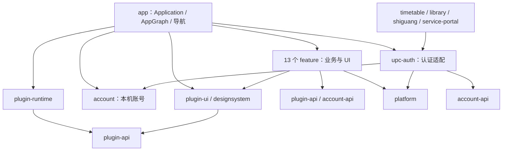
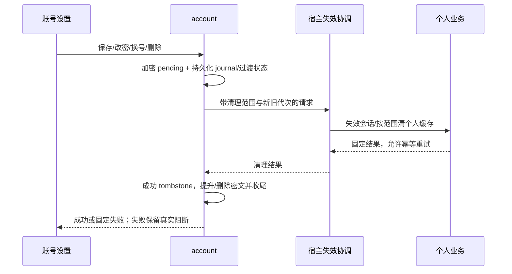

# UPC Pocket 当前架构

本文于 2026-11-22 核对 2.1.0 开发代码的日程待办位置（课表/专注）。M0–M5 和 v0.1 方案保留当时的决策与验证。 [正式版及下载](README.md) · [版本与工具链](docs/BUILD.md) · [2.0.8 开发记录](docs/releases/2.0.8-development.md) · [ADR](docs/adr/README.md)

## 系统轮廓

这是直接访问学校服务的 Android 客户端，没有本项目自建的账号或业务中转服务器。另有独立的 iOS 静态网页版（`web/`），同样不设账号服务、数据库或 `/api/*` 接口，见下文「iOS 网页版」。Compose / Material 3 负责展示；手动 AppGraph 负责装配；feature 纵向拥有业务、数据和 UI；Room、DataStore 与私有文件承担各自持久化。OkHttp 处理网络，受控 WebView 只承担已有学校网页流程。版本目录中的 Hilt 条目不表示已迁移到 Hilt。

图展示主要方向；各模块准确直接依赖以下表和 Gradle 为准。并非每个 feature 都依赖图中所有公共模块。

## 模块与依赖

[settings.gradle.kts](settings.gradle.kts) 当前包含 22 个模块，包括 app、8 个 core 和 13 个 feature。表中依赖只列仓库内部直接 project 依赖。

| 模块 | 职责 | 内部直接依赖 |
| --- | --- | --- |
| `app` | Application、装配、导航/首页/设置、系统入口、更新、诊断存储导出 | 下列全部 core 与 feature |
| `core:plugin-api` | 纯 JVM 插件标识、描述符、能力和生命周期契约 | 无 |
| `core:plugin-runtime` | 纯 JVM 注册、拓扑排序、校验、激活和能力解析 | plugin-api |
| `core:plugin-ui` | Compose 页面、入口、设置区和底栏贡献契约/registry | plugin-api |
| `core:account-api` | 纯 JVM 账号状态、受控身份/引用、代次和失效契约 | 无 |
| `core:account` | 本机加密凭据、事务恢复、清理协调、账号设置 UI | account-api、platform、designsystem |
| `core:upc-auth` | UPC CAS 与各业务认证适配，短期使用凭据 | account、account-api、platform |
| `core:platform` | 基础加密、账号脱敏、固定诊断模型 | 无 |
| `core:designsystem` | Compose 主题、通用 UI、RemoteViews 支持 | 无 |
| `feature:card` | 余额/流水/充值协议与状态、页面、余额组件渲染 | account-api、designsystem、platform、plugin-api、plugin-ui |
| `feature:power` | 唐岛湾电量、输入、快照与组件渲染 | designsystem、platform、plugin-api、plugin-ui |
| `feature:classroom` | 两校区公开空教室查询、缓存、条件与页面 | designsystem、platform、plugin-api、plugin-ui |
| `feature:library` | libseat 与超星座位、会话/本人校验、查询与预约 UI、个人隐藏 | account-api、upc-auth、designsystem、platform、plugin-api、plugin-ui |
| `feature:focus` | 本机计时、专注数据库、统计、通知与前台服务 | designsystem、plugin-api、plugin-ui |
| `feature:timetable` | 学期/周查询、账号绑定只读缓存、周网格/今日课程、组件渲染 | account-api、upc-auth、designsystem、platform、plugin-api、plugin-ui |
| `feature:grades` | 成绩只读同步、账号绑定的加密学期快照、总览及可筛选课程明细 | account-api、upc-auth、designsystem、platform、plugin-api、plugin-ui |
| `feature:todo` | 本机任务、截止和排序，独立 Room、一次性提醒、通知动作与组件渲染 | designsystem、plugin-api、plugin-ui |
| `feature:shiguang` | 活动、详情、五模块学分学时与本人记录，只读 | account-api、upc-auth、designsystem、platform、plugin-api、plugin-ui |
| `feature:service-portal` | 事项指南、待处理与在办，只读 | account-api、upc-auth、designsystem、plugin-api、plugin-ui |
| `feature:campusmap` | 两校区地图、地点搜索、步骑算路与前台引导 | plugin-api、plugin-ui |
| `feature:floorplan` | 卓越教学楼 A、B 区的原生离线平面图与房号搜索 | designsystem、plugin-api、plugin-ui |
| `feature:directory` | 校园通讯录、校区筛选、办事搜索、公开电话及地址 | designsystem、plugin-api、plugin-ui |

feature 之间不相互依赖，core 不依赖 app/feature，业务 feature 不依赖账号实现。card 的认证适配由宿主注入，表中的五个 feature 通过 `upc-auth` 使用相应认证契约。`platform` 不承载课程、余额或图书馆业务实体。[checkModuleBoundaries](build.gradle.kts) 检查 Gradle 依赖方向和指定核心白名单。

## 启动、扩展与导航

真实入口是 [UpcPocketApp](app/src/main/java/com/upcpocket/app/UpcPocketApp.kt) 与 [AppGraph](app/src/main/java/com/upcpocket/app/core/AppGraph.kt)。

1. 安装固定诊断 sink，显式注册内置插件并校验宿主 API、能力与插件依赖。
2. [PluginRuntime](core/plugin-runtime/src/main/kotlin/com/upcpocket/app/plugin/runtime/PluginRuntime.kt) 激活健康插件；[HostUiAssembly](app/src/main/java/com/upcpocket/app/core/HostUiAssembly.kt) 对各贡献 fork 校验后合并，失败插件及必需依赖者从最终集合移除。
3. debug 对装配失败快速报错；release 记录脱敏诊断后保留健康插件。生命周期和系统能力都从最终活动集合解析，不能绕过缺插件状态。
4. 轻量 Application 初始化后，先恢复本机账号及未完成清理，再恢复插件本机状态。插件构造不联网或写业务数据；恢复不等于自动登录全部业务。

扩展一个 feature 需同步 Gradle、PluginDescriptor/能力、宿主工厂与依赖注入、UI 贡献和缺插件行为；稳定 ID/路由/能力键是兼容契约。[API](API.md) 说明内部调用面。插件在同一 APK/进程中，不构成安全沙箱。

2.1.0 的宿主导航使用 HorizontalPager 承载首页、课表、服务和专注，浮动胶囊跟随 Pager。首页与服务由宿主提供，业务入口来自最终激活的插件，导航按稳定 route 解析。二级页使用 Navigation Compose。`LocalPluginPageActive` 防止预加载页查询或申请权限，`LocalDockClearance` 给内容末尾、FAB 和 Snackbar 留余量。首页右上角统一设置。服务页按插件元数据分类与搜索，首页固定偏好缺键采用四默认项，显式空集合保持为空。服务、首页固定及官方网页目录共用 `OfficialWebCatalog`。 [AppNav](app/src/main/java/com/upcpocket/app/ui/nav/AppNav.kt) · [M5 入口映射](docs/m5/README.md)

2.1.0 的日程待办默认装配在 `timetable.week` 上方，也可由「设置 → 应用 → 日程待办位置」改到 `focus` 页，位于计时控制与标签之间。宿主按最终 bottomNav、已注册页面和待办能力解析唯一可见槽位，两处复用同一 `TodoScheduleSection`；待办按设备本地日期从现有 `TodoStore.tasks` 派生，课程仍由课表模块按原学期和教学周提供。位置偏好只存在于宿主 `UiPrefsStore`。两个宿主都可用时一级入口始终四项；所选宿主缺失时保留已注册的 `todo.list` Tab，不改写偏好；只剩一个宿主且偏好尚未读到时，宿主推迟挂载 NavHost/Pager 与导航 effects，避免按临时层级消费通知或组件入口后重建丢失。`todo.list` 承载完整待办及任务、新建面板的系统入口。专注计时与标签不读取待办状态。

学习平台是宿主提供的二级页。服务页搜索、服务页入口与首页固定共用同一页面。浏览器交接复用 `OfficialWebCatalog.open`，由系统处理固定 HTTPS 链接。 [来源目录](docs/upc/官方入口.md#210-学习平台)

`core:designsystem` 提供 Material 3 主题及通用控件，配色、动态取色与深色模式偏好归宿主。2.0.8 候选中的应用内液态玻璃实验已撤下，取舍见 [ADR 006](docs/adr/006-2.0.8-material-theme-and-glass-widgets.md)与[性能记录](docs/releases/2.0.8-development.md)。

2.0.9 开发版由宿主提供常用校区，教室、图书馆与电费在页面进入时以保存的偏好初始化。服务页的官方网页按条目校区展示，完整目录覆盖两校区。电量组件继续直达唐岛湾原生页。 [开发入口映射](docs/m5/README.md#209-开发入口映射2026-11-19)

2.0.9 开发版另提供 opt-in 的轻量玻璃界面风格，默认仍为 Material 3，真机性能尚未验证；该偏好独立于桌面组件，历史取舍见 [ADR 006](docs/adr/006-2.0.8-material-theme-and-glass-widgets.md)。液态玻璃预研由宿主提供 [GlassEnvironment](core/designsystem/src/main/kotlin/com/upcpocket/app/ui/components/GlassSurfaces.kt)。Android 13 及以上的外层玻璃卡片共享一份可透出页面的半透明主题光源。小控件使用透明或低不透明度的底色。文字弹窗和短提示使用随主题变化的高不透明度底色，保留连续高光与描边。按压、焦点、选中值变化及弹窗展示时才播放短动效，沿用系统动画时长。底栏底板使用主题色、高光和描边。选中水滴交互时采样同窗口的主题渐变和导航图标，页面滚动无需为底栏录制导航内容。光学底栏用于 API 33 及以上，API 31–32 回退现有 Material 3 底栏。

待办浮层提示使用独立的列表采样层，提示本体、浮动按钮和导航位于采样范围之外。仅在提示存在时录制列表，模糊和边缘折光限制在提示外形内。提示与操作按钮透出同一采样层，边缘高光在透明面上绘制。

透明底部表单打开期间，宿主收起浮动导航，待办页收起浮动添加按钮，避免下方的操作控件与表单内容视觉重叠。

2.1.0 开发版的校园地图是二级插件页，通过服务目录及首页固定进入。AppGraph 注入常用校区和课表到地图的地点选择动作。课表详情通过宿主查找已激活的地图能力，仅把选中的地点文字交给地图内存中的一次请求。地图插件独立读取随应用分发的 OSM 数据与地点清单，在本机算路并消费前台定位，具体数据与验收边界见 [ADR 007](docs/adr/007-offline-campus-navigation.md)。

2.1.1 的卓越楼平面图由独立插件提供。「服务 → 学习与空间」和服务搜索共用 `floorplan.home`，打开后按需读取随包提供的结构化图形。楼层切换、图面变换与房号查找在本机完成，独立于校园地图、前台定位和学校账号。 [平面图插件](feature/floorplan/src/main/kotlin/com/upcpocket/app/floorplan/FloorPlanPlugin.kt)

校园通讯录从随应用分发的资料加载单位和办事信息。宿主注入常用校区及可用的地图能力。对于关联了可信地图地点的办公地址，宿主将校区和地点 ID 交给地图选中对应楼栋。

## 本机账号与业务会话

[SchoolAccountRepository](core/account/src/main/kotlin/com/upcpocket/app/account/SchoolAccountRepository.kt) 保存当前一个账号；保存状态只表示本机密文可靠提交。UI 显示“已保存”，内部仍为 `SAVED_UNVERIFIED`，不代表学校认证或业务登录。

凭据以独立 Keystore AES-GCM 加密保存在 noBackupFilesDir，pending/journal/state 支持中断恢复；已完成失效的 tombstone 不能重放破坏新状态。普通业务只拿 gate、内部 accountId、凭据代次及必要的受控学号。只有 `upc-auth` 可 opt-in 使用 [SchoolCredentialAccess](core/account/src/main/kotlin/com/upcpocket/app/account/SchoolCredentialAccess.kt) 的短期明文，释放时清零。

同号改密通常清会话、可保留该账号历史缓存；换号/删号/凭据不可读清个人会话与不能确认归属的数据。业务捕获账号/凭据/业务/查询代次，发布和落盘前再核对，清理失败保持阻断。宿主协调也覆盖插件未激活时的静态清理。专注、待办、个人隐藏座位、主题与寝室设置不随学校账号清除。

业务认证按核对过的学校入口完成正常 CAS，再建立各业务会话；账号保存、CAS 会话、各业务已有的本人核验和读取成功是不同阶段。课表索引没有学校本人字段，其本机账号/代次绑定不能表述为学校返回身份比对。密码和一次性票据不使用通用自动重试；验证码/二次验证交已有官方网页流程。真实 CAS 验收使用已授权本人真实账密，Mock 与合成夹具只证明其覆盖的本机逻辑。细节见 [PRIVACY](docs/PRIVACY.md)、[ADR 002](docs/adr/002-account-generation-and-business-sessions.md)。

## 核心业务数据流

- **校园卡余额**：统一账号受控学号 → CardBalanceService → 当前绑定 Repository/快照 → 页面或组件；不接受外部目标。余额不发送密码。迁移只接收同学号旧快照，失败/清理时不展示旧身份数值。2.0.7 第二部分主值在展示层取卡内余额与过渡余额之和，小字保留过渡明细；原始分字段及缓存格式不变。
- **本人流水**：宿主认证适配 → 校园卡业务 token → 本人核验 → 月份/分页/汇总 → 内存列表。用户主动加载全部才继续分页；仅成功完整集合可称完整结果。
- **微信充值**：进入页认证并只读准备 → 用户点击带金额充值按钮 → 可靠加密待查标记 → 单次订单/支付准备 → 微信分发 → 回到 App 只读查单。未知结果保留防重，不重下单；微信接受分发、用户付款、学校订单成功与余额更新分别判断。
- **图书馆**：libseat、超星 seat、seatengine 按各自协议登录/核验 → 房间/座位/时段读取 → 当前上下文预检 → 用户确认后单次写。提交后超时/畸形响应保持未知，不自动回官方页重复写。列表/地图由同一房间布局派生，共用原座位 ID 和时段；展示状态与坐标变换归 feature/library UI，不合并学校协议。个人隐藏进入房间后异步恢复，未完成或失败时阻止选择与确认，仅影响本机展示。唐岛湾同一 ViewModel 内的隐藏读写串行，切房再返回时等候旧写入完成，并按房间和代次校验后发布名单。真实预约/取消/签到尚未完成开发侧验收。
- **空教室/电量**：独立来源与查询键，不混入学校账号密码。教室失败或不完整不能显示成空闲；预设自动查、自选手动查。唐岛湾电量直接读取，古镇口通过学校页面。
- **石光/e站通**：业务独立认证/本人数据读取，正常网页登录是已有回退；活动报名、签到、事项提交等写操作不在范围。
- 打开**成绩与学分**时读取所属账号的本机快照。主动同步通过独立学校成绩会话取得学期索引及逐学期明细。学期索引查询成功后，即使本轮所有学期查询失败，也会保留已有结果和原成功时间。快照保存成功后，重开应用仍提示失败范围。点击学期或分布可在本机筛选明细。 [学校成绩来源](docs/upc/官方入口.md#211-成绩与学分学校来源)

## 只读课表与组件

[TimetableService](feature/timetable/src/main/kotlin/com/upcpocket/app/timetable/TimetableService.kt) 首入/刷新确认真实学期和当前周，再按需查周；历史缓存的 currentWeek 不作为学校现状。用户查看周与实际今日状态分开，上海时区实际日期驱动首页今日课程和桌面组件。周网格连续周日至周六，官方 1–12 节作息与 13–14 节“时间待确认”规则见[设计](docs/m5/2026-11-05-课表与组件设计.md)。

2.1.1 开发版由 `app` 将待办插件持有的个人日程订阅和编辑入口注入课表 UI。首页在「今日安排」合并两种来源，学校课程仍按当前账号与上海实际日期核对，本机日程可独立显示。课表按周选择日期查看个人日程，课表和首页使用上海时区，日程待办使用设备本地时区。 [内部契约](API.md#业务能力与系统消费者)

2.1.1 开发版的课表页在可拖模块之外提供「全部 / 仅看课程」切换。宿主将选择保存在 `UiPrefsStore` 并注入课表页。切至仅看课程时，移除该页的日程待办、个人日程和日期日程入口，停止关联的窗口订阅及计时。两种展示共用同一 `TimetableService` 和当前学期、教学周。

周缓存只保存完整成功且归属当前账号的结果。失败保留历史缓存并标示，完整空周、未查询、无缓存与协议失败不混同。会话单独加密；本机周缓存本身未单独加密，依赖应用沙箱与 noBackup 范围。新课表不读 focus 的停用兼容表。

四类 RemoteViews 的渲染器分别归 card/power/timetable/todo，Provider、点击 Intent 和 Worker 归 app。课表和校园卡使用整卡导航，电量另有手动刷新。2.0.8 为每类组件增加一个固定使用静态磨砂背景的 Launcher Provider，复用业务布局和动作。原组件继续使用原 Provider 身份与宿主 `UiPrefsStore` 中的全局外观偏好，保存只本地重绘。玻璃版与原组件共享数据、校园卡发布屏障和同类调度，最后一个同类实例移除时取消调度。

2.1.0 增加「本周课表」，2.1.1 开发版增加「今明课表」。课表模块从当前账号的缓存按上海日期查找每一天的课程，供周日至周六和今明两种视图使用。渲染器接收日期、节次、课名与覆盖状态，两种组件使用全局桌面外观。宿主负责整卡导航与发布校验。只放置今明、本周或两者时，课表组件的时刻边界为上海午夜。 [桌面入口](docs/m5/README.md#210-后开发改动2026-11-24未发布)

待办组件经最终 `TodoStore` 能力异步读取 Room 的有限摘要与全部未完成数，区分尚未恢复、读取失败、缺插件和有效空。存储/revision 变化经宿主注入的窄回调刷新所有实例，不依赖 Activity 收集 Flow。完成 Receiver 非导出，仅框架勾选值需要可变 PendingIntent；实例、完整 UUID、revision 与目标 true 绑定 Intent 身份，旧动作不能重绑新版本。新建与导航保持 immutable，冷/暖 Activity 经同一契约解析并仅在活动待办页消费；桌面不承载编辑输入。[TodoWidgetTicker](app/src/main/java/com/upcpocket/app/widget/TodoWidgetTicker.kt) 在截止和设备本地午夜安排本地重绘，最后实例移除取消，不使用校园网络或常驻服务。

[TimetableWidgetTicker](app/src/main/java/com/upcpocket/app/widget/TimetableWidgetTicker.kt) 安排上海午夜的一次性本地重绘。放置「今日课表」标准版或玻璃版时，同时考虑课程开始、结束和上课期间的下一个整分钟边界。各课表组件共用该调度，[WidgetAutoRefresh](app/src/main/java/com/upcpocket/app/widget/WidgetAutoRefresh.kt) 维护 30 分钟本地周期兜底。重绘与续排分开，防止同名任务替换正在运行的自身或每次渲染重置等待；自动课表路径不调用会联网的 `open()`，不登录 CAS，也不遍历未缓存周。校园卡另有独立的 30 分钟联网条件任务，仅存在组件时保留，首轮在联网条件满足后执行，不额外叠加一次性查询；执行时有界恢复本机账号并由 `CardBalanceService` 读取当前受控本人余额。周期不因重绘而重置，最后组件删除取消；无账号、清理中或插件不可用时不查询。

[WidgetTimeReceiver](app/src/main/java/com/upcpocket/app/widget/WidgetTimeReceiver.kt) 只接收固定的时间/时区、开机和应用包更新系统动作，保持非导出，只处理本地重绘及调度恢复。沿用 WorkManager，不新增精确闹钟权限或常驻服务。省电等系统限制可能延迟分钟更新或下课切换。校园卡发布前复核绑定、业务和快照版本，失败保留所属账号历史数据。视觉与尺寸见[组件修订](docs/m5/2026-11-05-组件视觉修订.md)，本轮验证见 [2.0.9 开发计划](docs/design/2.0.9-update-plan.md#今日课表组件显示剩余上课时间)。

## 数据所有权与兼容

| 数据 | 所有者/方式 | 清理与兼容要求 |
| --- | --- | --- |
| 学校账密 | core/account；Keystore 密文、事务私有文件 | 不进系统备份；清理门闩/代次与 journal 协议兼容 |
| 余额快照 | card；带账号/学号/代次/查询时间的私有 JSON，未单独加密 | 同目标迁移；换号/清缓存拒绝旧值与迟到写回 |
| 校园卡流水 | card；运行期内存 | 离页/进程退出后不持久化列表；换号/改密失效 |
| 充值待查 | card；独立 Keystore 密文 | 可靠同步/读回后才请求；未知防重；同号改密保留用于查单 |
| 课表会话/周缓存 | timetable；会话密文、账号绑定私有 JSON | 会话与缓存分离；同号可保留历史，换号清理 |
| 成绩会话与学期快照 | grades 的内存会话与独立 Keystore 加密文件 | 同账号改密保留快照，换号或删号清理，包括插件未激活时 |
| 卓越楼平面图 | floorplan 的随包矢量数据、第 5 页共用线稿、图面房号和来源页 | 有来源依据时显示楼栋楼层，否则明确显示原图图注。搜索用图层与房间下标定位，图形随应用升级更新 |
| 图书馆会话/隐藏偏好 | library；会话密文/内存、独立 DataStore 偏好 | 会话绑定账号；个人隐藏按系统/馆区/房间/座位隔离且换号保留 |
| 专注数据 | focus；Room `upcpocket.db` v1 | 保留停用课表表结构及实体兼容，不清库、不擅自删表 |
| 待办、截止、排序与提醒 revision | todo 的 Room `upcpocket-todo.db` | 2.1.0 使用 v2，v1 → v2 添加可空截止。2.1.1 开发版 v3 新增任务排序和模式记录，保留原任务表及提醒状态。Alarm 和通知可从任务重建，旧动作按 taskId 与 revision 拒绝。 |
| 个人日程与起止时点 | todo 的 Room `upcpocket-todo.db` v4，独立 `personal_schedules` 表 | `3 → 4` 追加日程表与时间索引。个人日程和其 `revision` 独立于待办与学校账号。 |
| 配色与深色模式、桌面外观、首页固定、寝室与公开查询缓存 | 所属宿主/feature 的 DataStore 或缓存 | 学校账号清理保留这些本机选项；普通组件外观归 UiPrefsStore，固定玻璃版由 Provider 身份决定，首页固定项缺键与显式空集分别处理 |
| 自定义配色与自定义背景（开发改动，未发布） | app 的 `UiPrefsStore`（`custom_theme_seed_argb`、`custom_background_opacity`）与私有 `noBackupFilesDir/appearance/custom_background.jpg` | 背景 JPEG 是唯一事实来源，导入/清除经存储层互斥串行并在成功后由 `CustomBackgroundStore.revision` 通知重新读盘；配色与可见度缺键分别回退默认种子色和默认可见度，可见度限制在 0.15–0.90；通过系统照片选择器无权限读取并下采样保存在本机，不随学校账号清理 |
| 常用校区 | app 的 `UiPrefsStore` | 缺有效偏好默认全部校区。教室在全部校区模式下沿用原有上次校区记录 |
| 日程待办位置 | app 的 `UiPrefsStore`（`todo_host_placement`） | 缺键或未知值回退课表页；只决定槽位页面，不改待办数据、提醒或系统入口；不随学校账号清理 |
| 首页纪念日（开发改动，未发布） | app 的 `UiPrefsStore`（`home_anniversary_*`） | 标题、以 epoch day 表示的日历日期、计时方式与显示开关在一次编辑中保存。未配置时隐藏，关闭显示及学校账号清理时保留配置 |
| 首页与课表页模块排序与拖动开关（开发改动，未发布） | app 的 `UiPrefsStore`（`home_module_order`、`timetable_module_order`、`module_reorder_enabled`） | 逗号分隔稳定枚举名；缺键或未知项归一化回退默认顺序，重排可见子集时保留隐藏模块相对位置；开关缺键默认关闭，关闭时仍渲染已保存顺序并锁定，排序写回在同一 edit 内复核开关；不随学校账号清理 |
| 课表页展示范围（开发改动，未发布） | app 的 `UiPrefsStore`（`timetable_display_mode`） | 以枚举名保存，缺键或未知值使用「全部」。控制课表页本机日程内容显隐，学校账号清理后保留 |
| 应用内界面风格 | app 的 `UiPrefsStore`（`app_ui_style`） | 缺键或未知值保持 Material 3；不读取或清除旧候选的 `ui_style` 键；不随学校账号清理，也不改变桌面组件 |
| 诊断/更新缓存 | app；有界专用目录 | 诊断主动导出；更新仅校验后安装，provider 互相独立 |

数据模型归业务模块，不能把所有表或凭据移到公共模块。Room schema/file name、Keystore alias、DataStore 文件/键、私有文件格式和稳定 PendingIntent 都属于兼容面；变更需给出迁移与恢复依据。见 [ADR 003](docs/adr/003-data-ownership-and-schema-compatibility.md)。

## iOS 网页版（静态 PWA）

[`web/`](web/) 是独立的静态 PWA，不属于 Android Gradle 模块，也不需要 Android 工具链。浏览器使用哈希路由切换首页、课表、服务、待办和专注；服务目录使用站内公开数据和固定官方入口。通讯录、地图路网、卓越楼矢量楼层与第 5 页共用线稿存于同源静态资源，搜索和算路在浏览器内完成。校历索引随版本发布，原图由教务处提供。站内不收集学校账密，学校登录、预约、支付和实时查询由官方页面处理。

待办、个人日程、专注状态与历史、导入的学期课表保存在当前浏览环境的 IndexedDB（数据库 `upc-pocket`）。v3 追加日程仓库，保留旧对象仓库。常用校区、服务固定等偏好保存在 `localStorage`。前台定位数据留在运行内存。专注的活动状态及结束记录在同一事务内结算。V3 学期课表在浏览器内严格校验后按学年和学期整体提交，失败保留旧快照；`.ics` 只作当前页面内存中的临时预览。详见 [本机课表决策](docs/adr/009-web-semester-timetable-import.md)。

Service Worker 按部署范围和版本缓存允许列表中的静态资源；`.ics` 解析器与 Safari 书签脚本按需加载并进入离线缓存。网站数据与静态缓存分别维护，清除站点数据会移除本机记录。静态 HTTPS 地址和安装身份需保持稳定。整体决策见 [ADR 008](docs/adr/008-ios-pwa-local-data-and-school-links.md) 和 [ADR 010](docs/adr/010-safari-static-campus.md)。使用与验证边界见 [iOS 网页版](docs/web.md)。

## 更新、诊断与验证边界

更新信任链为固定仓库/线路 → 内置 P-256 公钥验原始清单 → 解析固定字段 → 大小/SHA/包名/内部版本/minSdk/当前证书校验 → PackageInstaller 系统确认。源码 namespace 不决定安装包身份；新旧包独立，latest 同批保留两套清单，旧线路仍指 2.0.3。发布脚本只准备附件，不上传。详见 [更新机制](docs/updates/README.md)与 [ADR 004](docs/adr/004-release-identity-and-update-trust.md)。

诊断固定词汇归 platform，存储、摘要和分享归 app，业务只发固定事件。schema 5 网络阶段/耗时/计数不承载地址、请求正文或个人内容；缺失字段不补造，诊断失败不影响业务。清理需要拒绝旧事件，导出由用户主动触发。

现有保障包括 Kotlin 类型/opt-in、Gradle 模块边界、各模块单测、Android Lint 与有范围的 Release 安装/真实校园验收；没有已配置的仓库 CI，也没有完整自动化文档/API兼容检查。构建成功、Mock通过和历史验收不能替代本轮真实业务证据。[CONTRIBUTING](CONTRIBUTING.md) 规定按影响选择验证，避免非必要极端状态测试；[审计报告](docs/agent-native/2026-11-16-audit-and-delivery.md)列本轮实际检查与已知过时注释。
