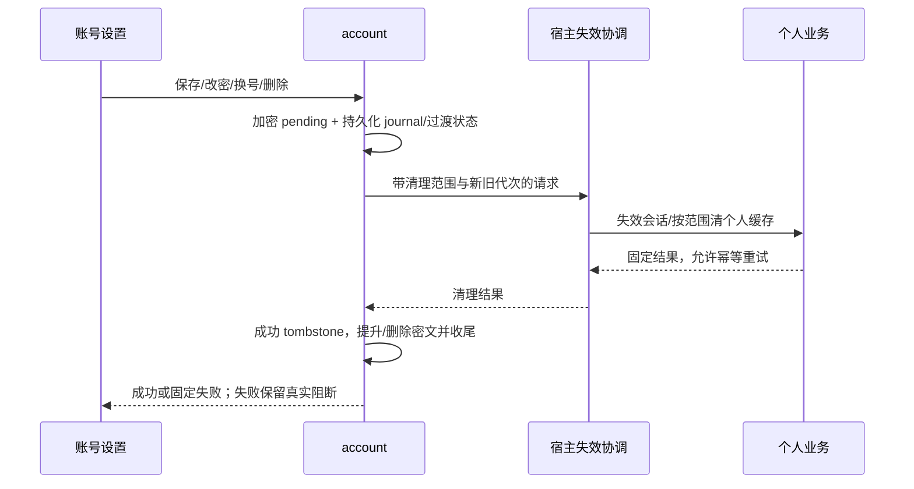

# UPC Pocket 当前架构

核对日期：2026-11-17。本文描述 2.0.8 开发源码；公开正式版仍为 2.0.7，产品与下载见 [README](README.md)，版本与工具链见 [BUILD](docs/BUILD.md)。开发中完成项及验证边界见 [开发记录](docs/releases/2.0.8-development.md)。M0–M5 和 v0.1 方案保留历史现场，不是待执行迁移清单。重要选择见 [ADR](docs/adr/README.md)。

## 系统轮廓

这是直接访问学校服务的 Android 客户端，没有本项目自建的账号或业务中转服务器；唯一例外是可选的 iOS 网页版多用户服务（`server/`，见下文「iOS 网页版」），Android 应用不依赖它。Compose / Material 3 负责展示；手动 AppGraph 负责装配；feature 纵向拥有业务、数据和 UI；Room、DataStore 与私有文件承担各自持久化。OkHttp 处理网络，受控 WebView 只承担已有学校网页流程。版本目录中的 Hilt 条目不表示已迁移到 Hilt。

图展示主要方向；各模块准确直接依赖以下表和 Gradle 为准。并非每个 feature 都依赖图中所有公共模块。

## 模块与依赖

[settings.gradle.kts](settings.gradle.kts) 当前包含 18 个模块：app、8 个 core、9 个 feature。表中依赖只列仓库内部直接 project 依赖，省略外部库。

| 模块 | 职责 | 内部直接依赖 |
| --- | --- | --- |
| `app` | Application、装配、导航/首页/设置、系统入口、更新、诊断存储导出 | 下列全部 core 与 feature |
| `core:plugin-api` | 纯 JVM 插件标识、描述符、能力和生命周期契约 | 无 |
| `core:plugin-runtime` | 纯 JVM 注册、拓扑排序、校验、激活和能力解析 | plugin-api |
| `core:plugin-ui` | Compose 页面、入口、设置区和底栏贡献契约/registry | plugin-api |
| `core:account-api` | 纯 JVM 账号状态、受控身份/引用、代次和失效契约 | 无 |
| `core:account` | 本机加密凭据、事务恢复、清理协调、账号设置 UI | account-api、platform、designsystem |
| `core:upc-auth` | UPC CAS 与各业务认证适配，短期使用凭据 | account、account-api、platform |
| `core:platform` | 基础加密、账号脱敏、固定诊断模型 | 无 |
| `core:designsystem` | Compose 主题、通用 UI、RemoteViews 支持 | 无 |
| `feature:card` | 余额/流水/充值协议与状态、页面、余额组件渲染 | account-api、designsystem、platform、plugin-api、plugin-ui |
| `feature:power` | 唐岛湾电量、输入、快照与组件渲染 | designsystem、platform、plugin-api、plugin-ui |
| `feature:classroom` | 两校区公开空教室查询、缓存、条件与页面 | designsystem、platform、plugin-api、plugin-ui |
| `feature:library` | libseat 与超星座位、会话/本人校验、查询与预约 UI、个人隐藏 | account-api、upc-auth、designsystem、platform、plugin-api、plugin-ui |
| `feature:focus` | 本机计时、专注数据库、统计、通知与前台服务 | designsystem、plugin-api、plugin-ui |
| `feature:timetable` | 学期/周查询、账号绑定只读缓存、周网格/今日课程、组件渲染 | account-api、upc-auth、designsystem、platform、plugin-api、plugin-ui |
| `feature:todo` | 本机任务/截止、独立 Room、一次性提醒/通知动作与组件渲染 | designsystem、plugin-api、plugin-ui |
| `feature:shiguang` | 活动、详情、五模块学分学时与本人记录，只读 | account-api、upc-auth、designsystem、platform、plugin-api、plugin-ui |
| `feature:service-portal` | 事项指南、待处理与在办，只读 | account-api、upc-auth、designsystem、plugin-api、plugin-ui |

feature 之间不相互依赖，core 不依赖 app/feature；业务 feature 不依赖账号实现。card 的认证适配由宿主注入，其他四个需要 upc-auth 的模块按现有类型契约依赖它。`platform` 不承载课程、余额或图书馆业务实体。[checkModuleBoundaries](build.gradle.kts) 检查 Gradle 方向和指定核心白名单；不检查所有源码调用或运行时网络白名单。

## 启动、扩展与导航

真实入口是 [UpcPocketApp](app/src/main/java/com/upcpocket/app/UpcPocketApp.kt) 与 [AppGraph](app/src/main/java/com/upcpocket/app/core/AppGraph.kt)。

1. 安装固定诊断 sink，显式注册九个内置插件，校验宿主 API、能力与插件依赖；没有下载代码、热更新或反射发现。
2. [PluginRuntime](core/plugin-runtime/src/main/kotlin/com/upcpocket/app/plugin/runtime/PluginRuntime.kt) 激活健康插件；[HostUiAssembly](app/src/main/java/com/upcpocket/app/core/HostUiAssembly.kt) 对各贡献 fork 校验后合并，失败插件及必需依赖者从最终集合移除。
3. debug 对装配失败快速报错；release 记录脱敏诊断后保留健康插件。生命周期和系统能力都从最终活动集合解析，不能绕过缺插件状态。
4. 轻量 Application 初始化后，先恢复本机账号及未完成清理，再恢复插件本机状态。插件构造不联网或写业务数据；恢复不等于自动登录全部业务。

扩展一个 feature 需同步 Gradle、PluginDescriptor/能力、宿主工厂与依赖注入、UI 贡献和缺插件行为；稳定 ID/路由/能力键是兼容契约。[API](API.md) 说明内部调用面。插件在同一 APK/进程中，不构成安全沙箱。

[AppNav](app/src/main/java/com/upcpocket/app/ui/nav/AppNav.kt) 使用 HorizontalPager 承载首页/课表/服务/待办/专注，胶囊跟随 Pager；首页与服务为宿主目的地，业务 Tab 来自最终激活插件，导航按稳定 route 解析而非旧下标。二级页仍用现有 Navigation Compose。`LocalPluginPageActive` 防止预加载页查询或申请权限，`LocalDockClearance` 给内容末尾、FAB 和 Snackbar 留余量。首页右上角统一设置；多处快捷路径可指向同一路由。服务页按插件元数据分类与搜索，首页固定偏好缺键采用四默认项，显式空集合保持为空。校历为宿主固定公开外链，不依赖课表插件或账号；服务、首页固定及官方网页目录共用 `OfficialWebCatalog`。入口变化同步 [M5 映射](docs/m5/README.md)。

`core:designsystem` 提供 Material 3 主题及通用控件，配色、动态取色与深色模式偏好归宿主。五项导航继续使用浮动胶囊与 Pager。2.0.8 候选中的应用内液态玻璃实验已撤下，取舍见 [ADR 006](docs/adr/006-2.0.8-material-theme-and-glass-widgets.md)与[性能记录](docs/releases/2.0.8-development.md)。

## 本机账号与业务会话

[SchoolAccountRepository](core/account/src/main/kotlin/com/upcpocket/app/account/SchoolAccountRepository.kt) 保存当前一个账号；保存状态只表示本机密文可靠提交。UI 显示“已保存”，内部仍为 `SAVED_UNVERIFIED`，不代表学校认证或业务登录。

凭据以独立 Keystore AES-GCM 加密保存在 noBackupFilesDir，pending/journal/state 支持中断恢复；已完成失效的 tombstone 不能重放破坏新状态。普通业务只拿 gate、内部 accountId、凭据代次及必要的受控学号。只有 `upc-auth` 可 opt-in 使用 [SchoolCredentialAccess](core/account/src/main/kotlin/com/upcpocket/app/account/SchoolCredentialAccess.kt) 的短期明文，释放时清零。

同号改密通常清会话、可保留该账号历史缓存；换号/删号/凭据不可读清个人会话与不能确认归属的数据。业务捕获账号/凭据/业务/查询代次，发布和落盘前再核对，清理失败保持阻断。宿主协调也覆盖插件未激活时的静态清理。专注、待办、个人隐藏座位、主题与寝室设置不随学校账号清除。

业务认证按核对过的学校入口完成正常 CAS，再建立各业务会话；账号保存、CAS 会话、各业务已有的本人核验和读取成功是不同阶段。课表索引没有学校本人字段，其本机账号/代次绑定不能表述为学校返回身份比对。密码和一次性票据不使用通用自动重试；验证码/二次验证交已有官方网页流程。真实 CAS 验收使用已授权本人真实账密，Mock 与合成夹具只证明其覆盖的本机逻辑。细节见 [PRIVACY](docs/PRIVACY.md)、[ADR 002](docs/adr/002-account-generation-and-business-sessions.md)。

## 核心业务数据流

- **校园卡余额**：统一账号受控学号 → CardBalanceService → 当前绑定 Repository/快照 → 页面或组件；不接受外部目标。余额不发送密码。迁移只接收同学号旧快照，失败/清理时不展示旧身份数值。2.0.7 第二部分主值在展示层取卡内余额与过渡余额之和，小字保留过渡明细；原始分字段及缓存格式不变。
- **本人流水**：宿主认证适配 → 校园卡业务 token → 本人核验 → 月份/分页/汇总 → 内存列表。用户主动加载全部才继续分页；仅成功完整集合可称完整结果。
- **微信充值**：进入页认证并只读准备 → 用户点击带金额充值按钮 → 可靠加密待查标记 → 单次订单/支付准备 → 微信分发 → 回到 App 只读查单。未知结果保留防重，不重下单；微信接受分发、用户付款、学校订单成功与余额更新分别判断。
- **图书馆**：libseat、超星 seat、seatengine 按各自协议登录/核验 → 房间/座位/时段读取 → 当前上下文预检 → 用户确认后单次写。提交后超时/畸形响应保持未知，不自动回官方页重复写。列表/地图由同一房间布局派生，共用原座位 ID 和时段；展示状态与坐标变换归 feature/library UI，不合并学校协议。个人隐藏进入房间后异步恢复，未完成或失败时阻止选择与确认，仅影响本机展示。唐岛湾同一 ViewModel 内的隐藏读写串行，切房再返回时等候旧写入完成，并按房间和代次校验后发布名单。真实预约/取消/签到尚未完成开发侧验收。
- **空教室/电量**：独立来源与查询键，不混入学校账号密码。教室失败或不完整不能显示成空闲；预设自动查、自选手动查。唐岛湾电量直接读取，古镇口通过学校页面。
- **石光/e站通**：业务独立认证/本人数据读取，正常网页登录是已有回退；活动报名、签到、事项提交等写操作不在范围。

## 只读课表与组件

[TimetableService](feature/timetable/src/main/kotlin/com/upcpocket/app/timetable/TimetableService.kt) 首入/刷新确认真实学期和当前周，再按需查周；历史缓存的 currentWeek 不作为学校现状。用户查看周与实际今日状态分开，上海时区实际日期驱动首页今日课程和桌面组件。周网格连续周日至周六，官方 1–12 节作息与 13–14 节“时间待确认”规则见[设计](docs/m5/2026-11-05-课表与组件设计.md)。

周缓存只保存完整成功且归属当前账号的结果。失败保留历史缓存并标示，完整空周、未查询、无缓存与协议失败不混同。会话单独加密；本机周缓存本身未单独加密，依赖应用沙箱与 noBackup 范围。新课表不读 focus 的停用兼容表。

四类 RemoteViews 的渲染器分别归 card/power/timetable/todo，Provider、点击 Intent 和 Worker 归 app。课表和校园卡使用整卡导航，电量另有手动刷新。2.0.8 为每类组件增加一个固定使用静态磨砂背景的 Launcher Provider，复用业务布局和动作。原组件继续使用原 Provider 身份与宿主 `UiPrefsStore` 中的全局外观偏好，保存只本地重绘。玻璃版与原组件共享数据、校园卡发布屏障和同类调度，最后一个同类实例移除时取消调度。

待办组件经最终 `TodoStore` 能力异步读取 Room 的有限摘要与全部未完成数，区分尚未恢复、读取失败、缺插件和有效空。存储/revision 变化经宿主注入的窄回调刷新所有实例，不依赖 Activity 收集 Flow。完成 Receiver 非导出，仅框架勾选值需要可变 PendingIntent；实例、完整 UUID、revision 与目标 true 绑定 Intent 身份，旧动作不能重绑新版本。新建与导航保持 immutable，冷/暖 Activity 经同一契约解析并仅在活动待办页消费；桌面不承载编辑输入。[TodoWidgetTicker](app/src/main/java/com/upcpocket/app/widget/TodoWidgetTicker.kt) 在截止和设备本地午夜安排本地重绘，最后实例移除取消，不使用校园网络或常驻服务。

[TimetableWidgetTicker](app/src/main/java/com/upcpocket/app/widget/TimetableWidgetTicker.kt) 在课程开始、结束和上海午夜安排一次性本地重绘，[WidgetAutoRefresh](app/src/main/java/com/upcpocket/app/widget/WidgetAutoRefresh.kt) 维护 30 分钟本地周期兜底。重绘与续排分开，防止同名任务替换正在运行的自身或每次渲染重置等待；自动课表路径不调用会联网的 `open()`，不登录 CAS，也不遍历未缓存周。校园卡另有独立的 30 分钟联网条件任务，仅存在组件时保留，首轮在联网条件满足后执行，不额外叠加一次性查询；执行时有界恢复本机账号并由 `CardBalanceService` 读取当前受控本人余额。周期不因重绘而重置，最后组件删除取消；无账号、清理中或插件不可用时不查询。

[WidgetTimeReceiver](app/src/main/java/com/upcpocket/app/widget/WidgetTimeReceiver.kt) 只接收固定的时间/时区、开机和应用包更新系统动作，保持非导出，只处理本地重绘及调度恢复。沿用 WorkManager，不新增精确闹钟权限或常驻服务；系统省电可延迟执行，不承诺下课时刻准点更新。发布前继续复核绑定/业务/快照版本，失败保留所属账号历史数据。视觉/尺寸见[组件修订](docs/m5/2026-11-05-组件视觉修订.md)，实际验证见 [2.0.7 开发记录](docs/releases/2.0.7-development.md)。

## 数据所有权与兼容

| 数据 | 所有者/方式 | 清理与兼容要求 |
| --- | --- | --- |
| 学校账密 | core/account；Keystore 密文、事务私有文件 | 不进系统备份；清理门闩/代次与 journal 协议兼容 |
| 余额快照 | card；带账号/学号/代次/查询时间的私有 JSON，未单独加密 | 同目标迁移；换号/清缓存拒绝旧值与迟到写回 |
| 校园卡流水 | card；运行期内存 | 离页/进程退出后不持久化列表；换号/改密失效 |
| 充值待查 | card；独立 Keystore 密文 | 可靠同步/读回后才请求；未知防重；同号改密保留用于查单 |
| 课表会话/周缓存 | timetable；会话密文、账号绑定私有 JSON | 会话与缓存分离；同号可保留历史，换号清理 |
| 图书馆会话/隐藏偏好 | library；会话密文/内存、独立 DataStore 偏好 | 会话绑定账号；个人隐藏按系统/馆区/房间/座位隔离且换号保留 |
| 专注数据 | focus；Room `upcpocket.db` v1 | 保留停用课表表结构及实体兼容，不清库、不擅自删表 |
| 待办/截止/提醒 revision | todo；Room `upcpocket-todo.db` v2 | v1 显式新增可空 dueAt，旧任务截止为空且原字段保留；任务为事实，Alarm/通知可重建；旧动作按 taskId+revision 拒绝 |
| 配色与深色模式、桌面外观、首页固定、寝室与公开查询缓存 | 所属宿主/feature 的 DataStore 或缓存 | 学校账号清理保留这些本机选项；普通组件外观归 UiPrefsStore，固定玻璃版由 Provider 身份决定，首页固定项缺键与显式空集分别处理 |
| 诊断/更新缓存 | app；有界专用目录 | 诊断主动导出；更新仅校验后安装，provider 互相独立 |

数据模型归业务模块，不能把所有表或凭据移到公共模块。Room schema/file name、Keystore alias、DataStore 文件/键、私有文件格式和稳定 PendingIntent 都属于兼容面；变更需给出迁移与恢复依据。见 [ADR 003](docs/adr/003-data-ownership-and-schema-compatibility.md)。

## iOS 网页版

[`web/`](web/) 是独立的 PWA，无需 Android 工具链。浏览器使用哈希路由切换首页、课表、服务、待办和专注。待办、专注和导入的学期课表使用 IndexedDB，专注的活动状态及结束记录在同一事务内结算。Service Worker 按部署范围缓存版本化静态资源，网站数据和静态缓存分别维护。

公开数据查询与图书馆由 [`server/`](server/) 的多用户 Web 服务提供，核对于 2026-11-22：FastAPI + Redis + PostgreSQL，生产由 Caddy 终止 TLS 并从 [`web/`](web/) 提供静态文件、把 `/api/*` 反代到 `app:8080`，也可用 `SERVE_STATIC=true` 由应用直接提供 PWA 供本地预览。公开查询经 Redis 缓存（教室 60 秒，校历/目录/指南 1 小时），上游失败可返回上次成功缓存并在 JSON 标记 `stale`、响应头标记 `X-Cache: hit|miss|stale`；无缓存时返回 503 `upstream_unavailable`。学校协议仍由 [`tools/web/`](tools/web/) 的同步模块提供，`server/` 经桥接加载而不重写协议；[`tools/web/serve.py`](tools/web/serve.py) 仅保留为旧的本地单用户预览，不是生产入口。该服务是独立 Python 进程，不依赖也不改变 Android Gradle 模块边界。前端启动时加载默认教室结果；用户可在已登录的学校页主动运行 Safari 书签并导出本人课表，Pocket 在浏览器内校验粘贴或选取的 V3 JSON。完整学期以学年与学期为键一次提交，周视图、详情与首页今日摘要读取本机结果，iCalendar 保留为临时预览。见 [本机课表决策](docs/adr/009-web-semester-timetable-import.md)与 [iOS 网页版](docs/web.md)。

图书馆页提供唐岛湾、古镇口东区和求是三个站内入口。任意 iOS 设备在 HTTPS 下用站内登录对话框输入本人学校账号：浏览器取 RSA-OAEP-SHA256 公钥和一次性 nonce，用封装的一次性 AES-256-GCM 密钥加密账密，服务端解密一次、核对并消费 nonce 后走既有 CAS/libspace 或超星认证并立即丢弃明文；密码不落盘，nonce 阻止信封重放。图书馆业务令牌/Cookie 以 AES-256-GCM 密文存 Redis 并按 `user_id + branch` 绑定，预约记录在 PostgreSQL 按列加密。生产浏览器 Cookie 为 `__Host-upcp_session`（Secure/HttpOnly/SameSite=Lax），空闲 30 分钟、绝对 8 小时；馆区写请求需 `X-Library-Session` 与 `X-CSRF-Token`，非 GET 请求校验同源，登录限流 5 次/10 分钟/IP 与登录名（IP 只取 Caddy 追加的 `X-Forwarded-For` 最后一项并做 HMAC），预约按用户串行加锁。多用户按 `user_id` 与馆区隔离，预约沿用客户端 UUID 幂等，只有与本人、日期、房间、座位、完整时段唯一匹配的学校新记录才确认成功，结果未知时提示核对。唐岛湾站内可核对本人记录、确认并取消当前预约，超星两馆的本人记录和取消从对应官方页处理。本机回环方式见 [ADR 011](docs/adr/011-local-library-companion.md)，现已由 [ADR 012](docs/adr/012-multi-user-web-library-service.md) 更新；接口见 [Web 图书馆契约](API.md#web-图书馆预约)，部署见 [部署手册](deploy/README.md)。

## 更新、诊断与验证边界

更新信任链为固定仓库/线路 → 内置 P-256 公钥验原始清单 → 解析固定字段 → 大小/SHA/包名/内部版本/minSdk/当前证书校验 → PackageInstaller 系统确认。源码 namespace 不决定安装包身份；新旧包独立，latest 同批保留两套清单，旧线路仍指 2.0.3。发布脚本只准备附件，不上传。详见 [更新机制](docs/updates/README.md)与 [ADR 004](docs/adr/004-release-identity-and-update-trust.md)。

诊断固定词汇归 platform，存储、摘要和分享归 app，业务只发固定事件。schema 5 网络阶段/耗时/计数不承载地址、请求正文或个人内容；缺失字段不补造，诊断失败不影响业务。清理需要拒绝旧事件，导出由用户主动触发。

现有保障包括 Kotlin 类型/opt-in、Gradle 模块边界、各模块单测、Android Lint 与有范围的 Release 安装/真实校园验收；没有已配置的仓库 CI，也没有完整自动化文档/API兼容检查。构建成功、Mock通过和历史验收不能替代本轮真实业务证据。[CONTRIBUTING](CONTRIBUTING.md) 规定按影响选择验证，避免非必要极端状态测试；[审计报告](docs/agent-native/2026-11-16-audit-and-delivery.md)列本轮实际检查与已知过时注释。
