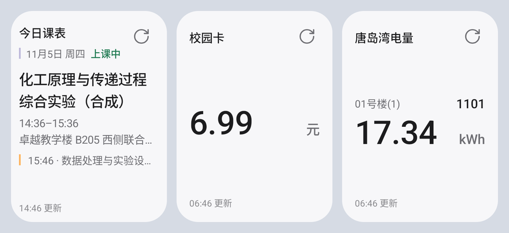
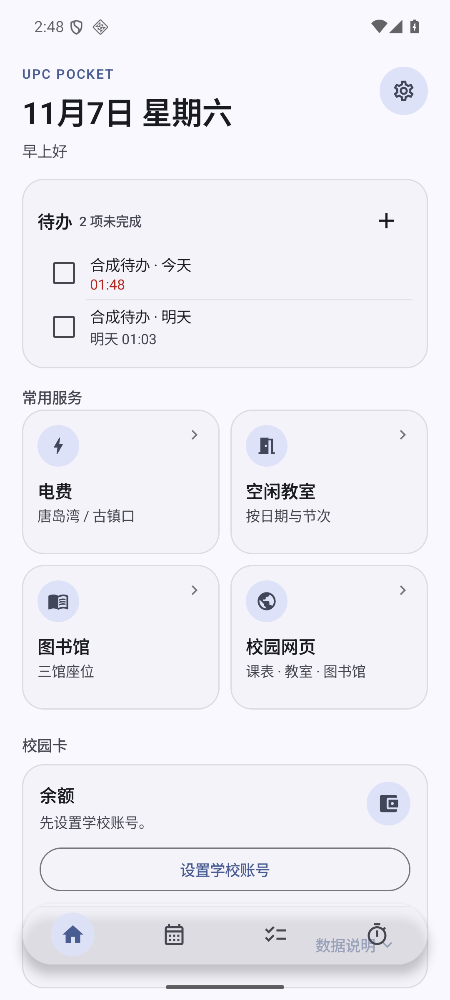

<div align="center">


# UPC Pocket

**把石大的日常，装进口袋。**

面向中国石油大学（华东）的轻量 Android 校园工具

[](https://github.com/dlam12138/UPCPocket/releases/latest)


[](LICENSE)

[**下载 2.0.4 新版（可选安装）**](https://github.com/dlam12138/UPCPocket/releases/download/v2.0.4/UPC-Pocket-2.0.4.apk) · [**国内加速**](https://gh-proxy.org/https://github.com/dlam12138/UPCPocket/releases/download/v2.0.4/UPC-Pocket-2.0.4.apk) · [**百度网盘**](https://pan.baidu.com/s/15ulVIs3PrZ2gQlc1gmE9vA?pwd=tvdv)（提取码：**tvdv**）

[继续使用 2.0.3 正式旧版](https://github.com/dlam12138/UPCPocket/releases/download/v2.0.3/UPC-Pocket-2.0.3.apk) · [旧版国内加速](https://gh-proxy.org/https://github.com/dlam12138/UPCPocket/releases/download/v2.0.3/UPC-Pocket-2.0.3.apk)

[版本与校验文件](https://github.com/dlam12138/UPCPocket/releases/latest) · [隐私说明](docs/PRIVACY.md) · [反馈问题](https://github.com/dlam12138/UPCPocket/issues)

<br />



<sub>今日课表、余额、电量，抬眼就能看见。图中内容为合成演示数据。</sub>

</div>

## 2.0.4 可选安装公告

**当前 2.0.3 已能满足日常使用，请按需更新。** 因原签名密钥丢失，2.0.4 无法覆盖旧版，现以 **UPC Pocket 新版**（`com.upcpocket.next`）独立安装，可与旧版并存。**旧版数据无法迁移到新版。**

新版需重新登录、设置提醒并添加桌面组件；旧待办、专注历史和设置无法迁移。需要新增功能时，再从上方网盘下载 `UPC-Pocket-2.0.4-next` 中的 APK。若同时使用两版，手动重建任务时请避免重复提醒。

新版使用固定长期 Release 签名；后续新版之间可沿用同一身份覆盖更新。2.0.4 已发布至 GitHub Releases，网盘作为备用下载；旧版更新线路继续保留 2.0.3，不向旧版推送不兼容更新。完整下载说明和校验值见 [2.0.4 安装公告](docs/releases/2.0.4-notice.md)。

## 常用的，都放在一起

首页、课表、待办、专注四个入口，左右滑动切页，底部胶囊随手势流畅切换。

| 功能 | 日常怎么用 |
| --- | --- |
| **校园卡余额与流水** | 保存学校账号，查询本人余额；余额卡内进入原生交易流水，支持分页、按月与收支汇总 |
| **宿舍电量** | 唐岛湾直接查询，古镇口打开学校页面 |
| **空闲教室** | 记住上次校区；预设条件自动查询，自选节次手动查询；古镇口支持卓越 A/B 筛选 |
| **图书馆座位** | 唐岛湾、古镇口东区、求是支持按时段找座位与个人隐藏，保留按座位选 |
| **课表** | 周日开头的整周视图、今日课程、节次时间；查过的周可离线看 |
| **待办与提醒** | 快速添加、完成、编辑与删除；可设一次性提醒，首页同步展示近期任务 |
| **专注** | 番茄钟、专注记录与统计，陪你完成一段学习 |
| **桌面组件** | 今日课表、校园卡、电量；默认 2×2，课表可拉宽至 4×2 |

支持浅色、深色与主题配色。学校认证遇到验证码时可转到网页登录；更新和诊断报告集中在关于页。

<div align="center">

<br /><sub>2.0.3 首页待办摘要与滑动导航，合成演示数据。</sub>
</div>

## 三步开始

1. **安装**：从上方链接下载 2.0.4 APK，支持 Android 12 及以上。新版独立安装，可与旧版并存。
2. **设置账号**：首页右上角 → 设置 → 学校账号。学校密码加密保存在本机，用于正常学校认证。
3. **按需使用**：保存账号后回课表点右上角刷新；添加待办、按需设置提醒，再把常用组件放到桌面。

从旧版转用 2.0.4 需要手动下载，旧版应用内更新不能安装这个独立新版。新旧更新线路分别维护；已安装新版 2.0.4 时，检查更新会显示已是最新版。

## 更新方便，反馈也方便

- **应用内更新**：检查新版本、选择下载线路、查看进度，校验通过后由系统确认安装；不自动下载、不强制更新。
- **诊断报告**：关于页可导出或清除本机诊断记录，不记录账密、会话或课程正文；只在你主动分享时发出。
- **问题反馈**：在 [Issues](https://github.com/dlam12138/UPCPocket/issues) 描述机型、版本、操作过程与实际现象。不要公开账号密码、验证码或带授权参数的链接。

## 使用前了解一下

这是**非学校官方应用**，校园查询直接访问对应学校服务，不经本项目自建账号服务器转发。

空闲教室反映学校排课，临时占用以现场为准；图书馆候选与最终可约以学校返回和预约记录为准。2.0.4 已将按时段找座位与个人隐藏扩展到古镇口东区、求是，真实预约、取消和签到尚未验证。待办提醒需通知权限；精确闹钟未授权或系统限制后台时可能延后，系统强行停止后需重新打开应用。课表第 13–14 节缺少已确认的官方时刻时，会显示“时间待确认”。

2.0.4 安装包约 **4.91 MiB**，使用独立长期签名。并存安装、新版自身覆盖保留本地状态、课表组件和诊断分享已在模拟器验证；尚未做本轮真机和校园业务完整回归。详细验证见 [新版验收记录](docs/releases/2.0.4-next-identity.md)，数据处理见 [隐私说明](docs/PRIVACY.md)。

<details>
<summary><strong>开发与文档</strong></summary>

<br />

Kotlin · Jetpack Compose / Material 3 · Room / DataStore · WorkManager · RemoteViews

```powershell
.\gradlew.bat :app:assembleRelease :app:testDebugUnitTest checkModuleBoundaries
```

使用 JDK 17+、Android SDK 36，默认构建 R8 + 资源压缩的通用 Release。机器路径、私钥和个人业务数据不入库。

[构建指南](docs/BUILD.md) · [项目文档](docs/README.md) · [开发规范](AGENTS.md) · [更新记录](docs/CHANGELOG.md) · [应用内更新机制](docs/updates/README.md)

研讨间研究资料保留归档，不属于当前产品功能；当前版本不含课程编辑、导出、课程提醒或充值；待办提醒独立提供。

</details>

## 致谢

基于 [ZZUPocket](https://github.com/3beuml/ZZUPocket) 演进，保留上游版权与 [MIT 许可证](LICENSE)；悬浮导航的来源与改动见 [移植说明](docs/third-party/ZZUPocket-dock.md)。Android 开发技能的固定来源与 Apache-2.0 许可证见 [来源说明](docs/android-skills.md)。

感谢 [@kujochisaki3378](https://github.com/kujochisaki3378) 在 [Issue #1](https://github.com/dlam12138/UPCPocket/issues/1) 提出时间优先筛选和个人隐藏座位的建议。2.0.3 先在唐岛湾实现，其他馆区仍保留原流程。

### 2.0.4 新增内容

2.0.4 / code 25 整合古镇口东区、求是布局与按时段找座位、个人隐藏、校园卡原生本人流水，以及古镇口空闲教室卓越 A/B 筛选，现已作为可选独立新版发布；上文展示的旧截图均已标明版本。历史图书馆候选 APK 不包含流水。详见 [2.0.4 发布记录](docs/releases/2.0.4.md)、[图书馆验收](docs/releases/2.0.4-chaoxing-library-parity.md)、[流水验收](docs/research/native-card-history.md) 与 [筛选验收](docs/releases/2.0.4-classroom-filter.md)。
