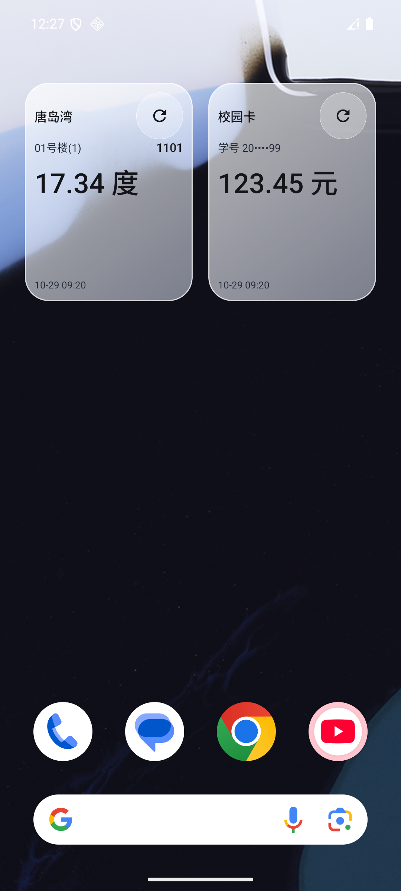
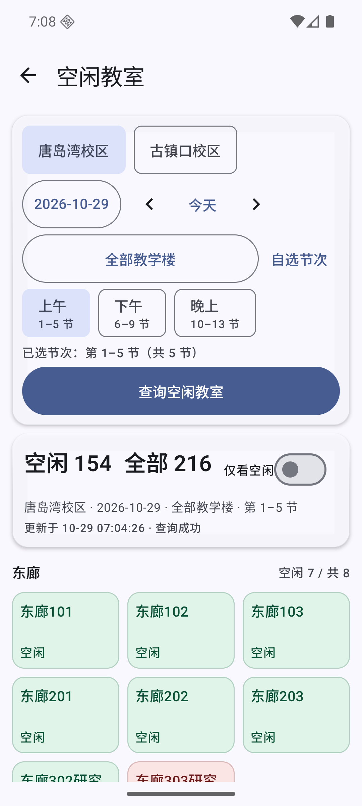

<div align="center">

# UPC Pocket · Lightly

**余额、电量、空教室，把常用校园服务放进口袋。**

面向中国石油大学（华东）的轻量 Android 工具


[](LICENSE)

[**下载 v0.2.7**](https://github.com/dlam12138/UPCPocket/releases/tag/v0.2.7) · [使用与隐私](docs/PRIVACY.md) · [更新记录](docs/CHANGELOG.md) · [本地构建](docs/BUILD.md)

</div>

## 日常所需，打开就用

| 功能 | 你可以做什么 |
| --- | --- |
| 校园卡余额 | 首页输入学号查询，保留输入，分别显示校园卡余额与过渡余额 |
| 宿舍电量 | 唐岛湾选楼号、填寝室号，应用内查询剩余电量并保留输入；古镇口打开学校页面 |
| 空闲教室 | 两校区、日期与教学楼筛选，按楼分组查看空闲/占用，支持快捷时段与自选节次 |
| 图书馆座位 | 学校统一认证后，在应用内查询座位、预约及取消，并核对当前预约状态 |
| 专注 | 番茄钟、专注记录与统计，支持浅色、深色和主题配色 |
| 桌面小组件 | 校园卡余额与唐岛湾电量，默认 **2×2**，点击刷新，显示上次成功查询的数值和时间 |

## 一眼看清

<div align="center">

&nbsp;&nbsp;

</div>

小组件预览中的账号、寝室和数值均为**虚构演示数据**；教室截图为公开数据的历史查询结果。

## 安装与使用

1. 从 [Releases](https://github.com/dlam12138/UPCPocket/releases/latest) 下载 APK，按需比对随附的 SHA-256 文件。支持 **Android 12 及以上**。
2. 已安装本项目预览版时直接覆盖安装，保留本地记录。v0.2.7 沿用兼容签名，包内版本为 `0.2.7-lightly-preview`（19）。
3. 在应用内成功查询一次校园卡余额或唐岛湾电量，再长按桌面添加对应小组件。
4. 点击组件刷新按钮更新数据；点击主体回到相应功能。旧 2×3 实例可删除后重新添加为 2×2，无需卸载应用。

组件只在你点击刷新时请求数据，失败时保留上次成功值与查询时间。透明度、圆角和可调整尺寸由桌面共同决定；当前使用半透明渐变与细描边，不依赖壁纸读取或截图权限，也不保证跨桌面的实时背景模糊。

## 数据与边界

- **非学校官方应用**，基于学校现有服务提供便利；结果、预约规则和系统可用性以校方为准。
- 学号、寝室配置、查询缓存与专注记录保留在设备内，不经本项目自建服务器转发。必要查询会发送到对应学校系统，详见 [隐私与数据说明](docs/PRIVACY.md)。
- 图书馆登录在学校认证页面完成，不保存密码；可选择记住有效业务会话，失效后重新登录。
- 部分校园服务使用 HTTP；古镇口电费保留官方页面入口，证书或网络异常时可能无法访问，不绕过证书校验。
- 当前轻量版不包含课表、校园卡流水、充值、数字石大或图书馆主页入口。

## 开发

Kotlin · Jetpack Compose / Material 3 · Room / DataStore · WorkManager · RemoteViews

```powershell
.\gradlew.bat :app:assembleDebug :app:testDebugUnitTest :app:lintDebug
```

使用 JDK 17、Android SDK 36；本机 SDK 路径放在被忽略的 `local.properties`。Linux/macOS 使用 `./gradlew`。签名配置和详细步骤见 [构建指南](docs/BUILD.md)，项目文档见 [文档索引](docs/README.md)。

## 致谢与许可

本项目基于 [ZZUPocket](https://github.com/3beuml/ZZUPocket) 的 Android 工程演进，保留上游版权与 [MIT 许可证](LICENSE)。UPC 接入按本校系统分别实现，不能将其他学校的接口、认证与宿舍规则直接套用。

Android 开发指导来源于 [android/skills](https://github.com/android/skills)，其 Apache-2.0 许可证与固定版本见 [来源说明](docs/android-skills.md)。
