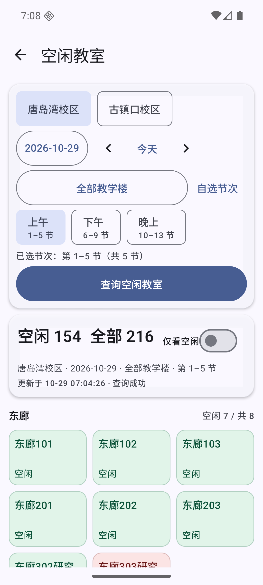

<div align="center">

# UPC Pocket · Lightly

**余额、电量、空教室、课表，把常用校园服务放进口袋。**

面向中国石油大学（华东）的轻量 Android 工具


[](LICENSE)

[**下载 v0.2.7**](https://github.com/dlam12138/UPCPocket/releases/tag/v0.2.7) · [使用与隐私](docs/PRIVACY.md) · [更新记录](docs/CHANGELOG.md) · [本地构建](docs/BUILD.md)

</div>

## 日常所需，打开就用

| 功能 | 你可以做什么 |
| --- | --- |
| 校园卡余额 | 在“首页 → 设置 → 学校账号”绑定本人学号后查询，展示脱敏学号、校园卡余额与过渡余额 |
| 宿舍电量 | 唐岛湾选楼号、填寝室号，应用内查询剩余电量并保留输入；古镇口打开学校页面 |
| 空闲教室 | 两校区、日期与教学楼筛选，按楼分组查看空闲/占用，支持快捷时段与自选节次 |
| 图书馆座位 | 学校统一认证后，在应用内查询座位、预约及取消，并核对当前预约状态 |
| 课表 | 使用当前统一学校账号完成学校正常认证；查看学期、教学周网格、今日课程与课程详情，只读并保留已成功查询周的离线缓存 |
| 专注 | 番茄钟、专注记录与统计，支持浅色、深色和主题配色 |
| 桌面小组件 | 校园卡余额与唐岛湾电量，默认 **2×2**，点击刷新，显示上次成功查询的数值和时间 |

## 一眼看清

<div align="center">

&nbsp;&nbsp;

</div>

小组件预览中的账号、寝室和数值均为**虚构演示数据**；教室截图为公开数据的历史查询结果。
M5 的原生页面第一版见 [M5 页面与视觉记录](docs/m5/README.md)；其中课表截图是明确标注的
Debug-only 合成预览，不是真实课程。

## 安装与使用

1. 从 [Releases](https://github.com/dlam12138/UPCPocket/releases/latest) 下载 APK，按需比对随附的 SHA-256 文件。支持 **Android 12 及以上**。
2. 已安装本项目预览版时直接覆盖安装，保留本地记录。v0.2.7 沿用兼容签名，包内版本为 `0.2.7-lightly-preview`（19）。
3. 唐岛湾电量建议先在应用内成功查询一次，再长按桌面添加对应小组件；校园卡组件只要已绑定学校账号即可添加并点击刷新，无需先有历史余额。
4. 点击组件刷新按钮更新数据；点击主体回到相应功能。旧 2×3 实例可删除后重新添加为 2×2，无需卸载应用。

组件只在你点击刷新时请求数据，失败时保留上次成功值与查询时间。透明度、圆角和可调整尺寸由桌面共同决定；当前使用半透明渐变与细描边，不依赖壁纸读取或截图权限，也不保证跨桌面的实时背景模糊。

## 数据与边界

- **非学校官方应用**，基于学校现有服务提供便利；结果、预约规则和系统可用性以校方为准。
- 学号、寝室配置、查询缓存与专注记录保留在设备内，不经本项目自建服务器转发。必要查询会发送到对应学校系统，详见 [隐私与数据说明](docs/PRIVACY.md)。
- 图书馆登录在学校认证页面完成；可选择记住有效业务会话，失效后重新登录。已发布 v0.2.7 不保存密码。
- **M1 开发分支（尚未发布）**新增“首页 → 设置 → 学校账号”：用户可主动将当前一个学校账号与密码用 Android Keystore 中独立密钥的 AES-GCM 加密保存在本机，界面显示“已保存，尚未验证”。保存不代表学校认证通过，也不会自动遍历或登录任何业务；课表与图书馆由对应页面在用户主动操作时使用这份账号的正常 CAS。删除账号会清理账密、关联会话和能确认归属的个人缓存，但保留专注历史、主题、公开教室与寝室配置。详见 [M1 执行记录](docs/m1/README.md)。
- **M2 开发分支（尚未发布）**把校园卡余额查询目标收束到当前统一账号：只读取登录名整串符合 8–16 位数字的本人学号，不再使用页面独立学号输入；无账号、恢复中、清理中、密文不可用或登录名不是有效学号时不联网。页面、2×2 组件和 WorkManager Worker 共用同一绑定服务；换号立即撤下旧余额，同号改密保留历史值但拒绝旧请求。组件最终写入使用 ticket 与绑定/账号代次/业务代次/快照版本门闩，迟到的旧读取不能覆盖新空态。旧 `card-balance-v1.json` 仅在用户绑定同一学号后迁移，异号/损坏/未绑定不展示。余额缓存清除与删除账号分开，清除失败会继续隐藏旧值并可在重启后重试。详见 [M2 执行记录](docs/m2/README.md)。
- **M3 开发分支（尚未发布）**新增“课表”tab：使用当前统一账号的正常 CAS 表单认证，只在核对后的 `cas.upc.edu.cn` HTTPS 页面提交密码；缺失或明确失效的课表业务会话最多恢复一次，错误密码不循环尝试，验证码/二次验证转到学校正常网页登录。首入只查询当前教学周，切周按需查询，不遍历整学期、不周期轮询。课程按周日起算的学校周次与 ISO weekday 对齐，保留非连续节次、单双周源周次与重叠课程；未提供字段显示“未提供”。成功周按内部 accountId + 学年/学期/教学周加密/原子缓存，离线只显示已成功查询周；换号/删号清理会话与缓存，迟到响应不写回。详见 [M3 执行记录](docs/m3/README.md)。
- **M4 开发分支（尚未发布）**图书馆座位新增“使用已保存学校账号登录”：通过正常 CAS 表单完成 libseat 统一认证、app token 与 seat token 兑换，并用 `/rest/v2/user` 核验返回本人与保存账号一致；手动 WebView 登录也经同一受控账号身份契约核验，A 账号下登录 B 不会发布或持久化。会话绑定 accountId/凭据代次，换号/删号/改密/清理失败时阻止旧会话恢复，旧恢复/旧自动/旧手动失败不能删除新登录。验证码或二次验证仍转到学校官方网页登录；没有保存账号时手动网页会话只保留内存。`nspace` 与 Chaoxing 四入口仍未原生接入，座位写操作不在本轮范围。详见 [M4 执行记录](docs/m4/README.md)。
- **M5 开发分支（尚未发布，第一版待评审）**顶级导航收束为 **首页 / 课表 / 专注**，取消“更多”tab；账号、图书馆登录、桌面组件、校园官方网页、外观和关于统一从首页右上角设置进入。首页服务卡仍由插件贡献，课表/专注 tab 由插件贡献；旧入口映射见 [M5 记录](docs/m5/README.md)。视觉去掉玻璃叠层，课表重做教学周/今日课程/横向周网格/详情和离线/空周/失败状态；未添加 Navigation 3、AGP 9、Glance 或未实现的校园能力。
- 部分校园服务使用 HTTP；古镇口电费保留官方页面入口，证书或网络异常时可能无法访问，不绕过证书校验。课表/CAS 只走 HTTPS，不关闭证书校验。
- 当前轻量版不包含课程编辑、日历导出、提醒、课表桌面组件、校园卡流水、充值、数字石大或图书馆主页入口。

## 开发

Kotlin · Jetpack Compose / Material 3 · Room / DataStore · WorkManager · RemoteViews

```powershell
.\gradlew.bat :app:assembleDebug :app:testDebugUnitTest :app:lintDebug
```

使用 JDK 17、Android SDK 36；本机 SDK 路径放在被忽略的 `local.properties`。Linux/macOS 使用 `./gradlew`。签名配置和详细步骤见 [构建指南](docs/BUILD.md)，项目文档见 [文档索引](docs/README.md)。

## 致谢与许可

本项目基于 [ZZUPocket](https://github.com/3beuml/ZZUPocket) 的 Android 工程演进，保留上游版权与 [MIT 许可证](LICENSE)。UPC 接入按本校系统分别实现，不能将其他学校的接口、认证与宿舍规则直接套用。

Android 开发指导来源于 [android/skills](https://github.com/android/skills)，其 Apache-2.0 许可证与固定版本见 [来源说明](docs/android-skills.md)。
