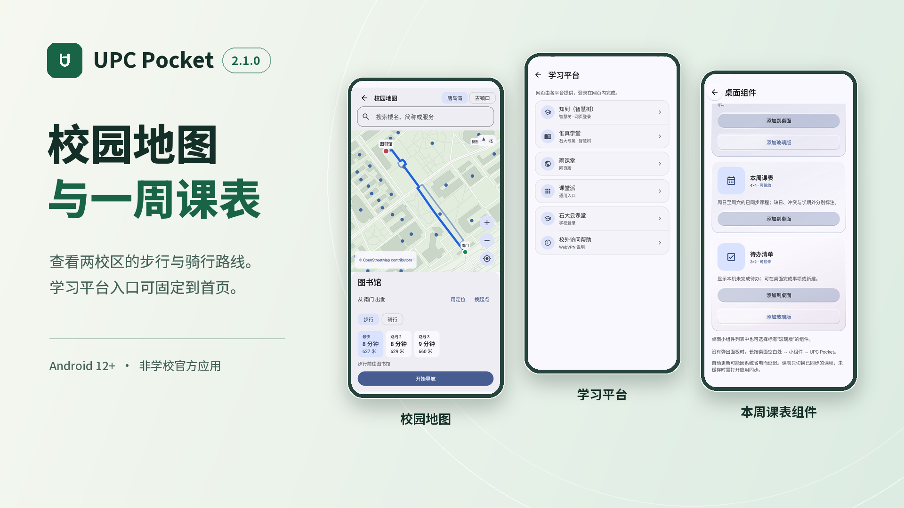

# UPC Pocket

面向中国石油大学（华东）的非官方校园工具，支持 Android 12 及以上。

[**下载 2.1.0**](https://github.com/dlam12138/UPCPocket/releases/download/v2.1.0/UPC-Pocket-2.1.0.apk) · [**国内加速**](https://gh-proxy.org/https://github.com/dlam12138/UPCPocket/releases/download/v2.1.0/UPC-Pocket-2.1.0.apk) · [更新说明与校验文件](https://github.com/dlam12138/UPCPocket/releases/tag/v2.1.0)

[用户手册](docs/USER-GUIDE.md) · [隐私说明](docs/PRIVACY.md) · [反馈问题](https://github.com/dlam12138/UPCPocket/issues)

离线 Android 模拟器界面，课表使用演示数据。

## 主要功能

| 功能 | 可以做什么 |
| --- | --- |
| 课表与学习 | 在首页看今日课程，在课表页看一周。已同步的课表可离线查看。服务页集中提供学习平台和教务网页入口。 |
| 地图与通讯录 | 在唐岛湾和古镇口搜索地点，预览步行、骑行路线。骑行接步行时会标出下车点。前台导航需定位，古镇口西区路网待补。通讯录可查公开电话及地址。 |
| 校园生活 | 查校园卡余额和本人流水、微信充值、查宿舍电量、找空闲教室和图书馆座位。古镇口电量通过学校网页查询。场馆预约在学校公众号办理。 |
| 校园办事 | 石光可查活动、学分学时与参与记录。e站通可查办事指南和本人事项。 |
| 待办与专注 | 本机待办支持截止时间与一次性提醒，可从课表页移到专注页。专注页提供番茄钟、记录与统计。 |
| 桌面组件 | 今日课表、校园卡、电量、待办和 4×4「本周课表」。 |

> 2.1.1 开发中。「服务 → 学习与空间 → 卓越楼平面图」可离线查看古镇口卓越教学楼 A、B 区，切换楼层、缩放图面并查找房号。同一分类下的「成绩与学分」可在应用内同步本人教务成绩，查看已同步学期的绩点、学分总览和课程明细，也可固定到首页。可在「设置 → 应用 → 首页纪念日」设置正计时或倒计时，在首页日期下方查看。可从课表或日程待办添加带起止时间的本机个人日程，首页「今日安排」同时显示当天的课程和个人日程。「设置 → 桌面组件」新增「今明课表」，可在桌面并排查看已同步的今明课程。课表和专注的日程待办可在原行勾选或取消完成。「全部待办」可按日期、重要程度或手动排序，日程待办沿用所选模式。外观支持自定义背景图与取色卡。开启「设置 → 应用 → 允许拖动卡片」后，可长按调整首页和课表的卡片顺序。该开关默认关闭。 [2.1.1 更新计划](docs/design/2.1.1-update-plan.md)

## 开始使用

1. **安装。** 下载 APK，按系统提示安装。已安装 2.0.4–2.0.9 可覆盖升级，也可在「首页 → 设置 → 关于 UPC Pocket → 更新」检查更新。
2. **同步课表。** 在「首页 → 设置 → 学校账号」保存本人账号和密码，再回到课表页点右上角刷新。账密加密保存在本机，校园查询直连对应学校服务。
3. **按需设置。** 在「首页 → 设置 → 校园」选常用校区，长按桌面空白处添加小组件。课表组件使用已同步的课程。

2.0.3 旧版可与新版并存。从旧版转用新版时需重新设置账号、提醒和小组件。 [下载旧版 2.0.3](https://github.com/dlam12138/UPCPocket/releases/download/v2.0.3/UPC-Pocket-2.0.3.apk) · [旧版国内加速](https://gh-proxy.org/https://github.com/dlam12138/UPCPocket/releases/download/v2.0.3/UPC-Pocket-2.0.3.apk)

## 开发

Android 版使用 Kotlin、Jetpack Compose、Room 和 WorkManager。 [构建指南](docs/BUILD.md) · [贡献流程](CONTRIBUTING.md) · [项目文档](docs/README.md) · [更新记录](docs/CHANGELOG.md)

## 许可与致谢

项目基于 ZZUPocket 演进，保留上游版权与 MIT 许可证。 [ZZUPocket](https://github.com/3beuml/ZZUPocket) · [MIT 许可证](LICENSE) · [Android 技能来源与许可](docs/android-skills.md)

校园地图及派生路网使用 © OpenStreetMap contributors 数据，按 ODbL 1.0 分发。 [地图数据来源与许可](docs/adr/007-offline-campus-navigation.md)

感谢 @kujochisaki3378 提出时间优先筛选和个人隐藏的建议，感谢 PR #5 作者贡献校园卡原生微信充值，感谢 Lycoris 贡献网页设计与课表导入。 [Issue #1](https://github.com/dlam12138/UPCPocket/issues/1) · [PR #5](https://github.com/dlam12138/UPCPocket/pull/5) · [PR #16](https://github.com/dlam12138/UPCPocket/pull/16)

感谢或许是小鸡、讨厌星期四和油利奈绪的反馈与调试支持。 [贡献与反馈致谢](docs/releases/2.0.8-notice.md#致谢)
