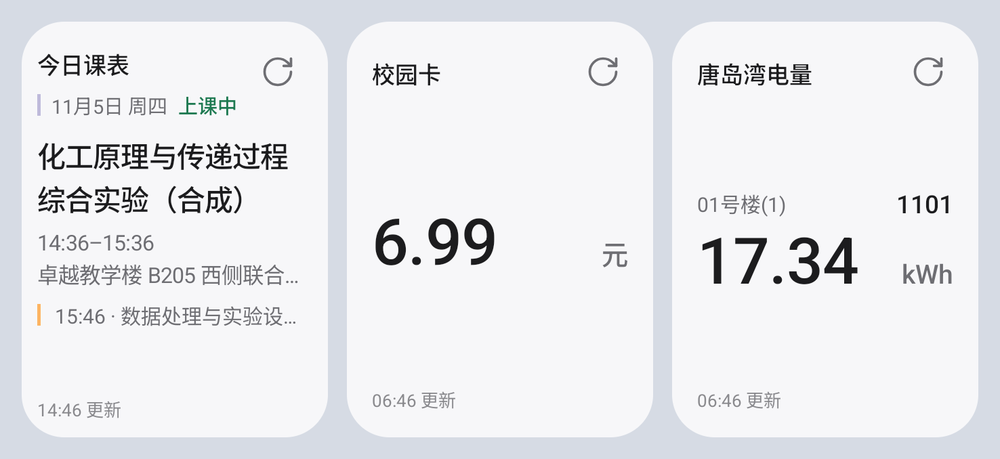
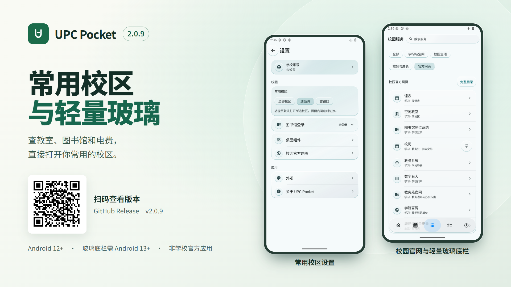

<div align="center">


# UPC Pocket

**把石大的日常，装进口袋。**

面向中国石油大学（华东）的轻量 Android 校园工具

[](https://github.com/dlam12138/UPCPocket/releases/latest)


[](LICENSE)

[**下载 2.0.9**](https://github.com/dlam12138/UPCPocket/releases/download/v2.0.9/UPC-Pocket-2.0.9.apk) · [**国内加速**](https://gh-proxy.org/https://github.com/dlam12138/UPCPocket/releases/download/v2.0.9/UPC-Pocket-2.0.9.apk)

[继续使用 2.0.3 正式旧版](https://github.com/dlam12138/UPCPocket/releases/download/v2.0.3/UPC-Pocket-2.0.3.apk) · [旧版国内加速](https://gh-proxy.org/https://github.com/dlam12138/UPCPocket/releases/download/v2.0.3/UPC-Pocket-2.0.3.apk)

[用户手册（2.1.0）](docs/USER-GUIDE.md) · [学校手册（2.1.0）](docs/SCHOOL-GUIDE.md) · [版本与校验文件](https://github.com/dlam12138/UPCPocket/releases/latest) · [隐私说明](docs/PRIVACY.md) · [反馈问题](https://github.com/dlam12138/UPCPocket/issues)

<br />



<sub>今日课表、余额、电量。历史组件图使用合成演示数据；2.0.7 课表和校园卡已移除刷新按钮，并增加自动更新与总余额显示。</sub>

</div>

## 2.0.9 · 常用校区与轻量玻璃

**2.0.9 已于 2026-11-19 正式发布。** 保存常用校区后，空闲教室、图书馆和电费会优先打开所选校区。服务页新增四个校园官网入口。周课表仅将节次重叠的课程并排，桌面「今日课表」可显示上课剩余分钟。

本版新增可选轻量玻璃，并修复首页回弹、唐岛湾选座的「现在」确认和放大座位图后的座号重叠。

已安装新版 2.0.4–2.0.8 可在应用内检查更新或覆盖安装。同签名的 2.0.9 rc4 也可覆盖升级。旧版 2.0.3 可与新版并存，首次使用新版需重新设置账号、提醒和桌面组件。

<div align="center">

<br /><sub>验收包界面实拍。二维码指向 2.0.9 Release。<a href="docs/images/2.0.9/promo/README.md">图片说明</a></sub>
</div>

[2.0.9 更新公告](docs/releases/2.0.9-notice.md) · [发布记录与校验值](docs/releases/2.0.9.md) · [2.0.8 发布记录](docs/releases/2.0.8.md)

## 常用的，都放在一起

底部提供首页、课表、服务、待办、专注五个入口，支持左右滑动切页。

| 功能 | 日常怎么用 |
| --- | --- |
| **校园卡余额、流水与充值** | 查询本人余额与流水；原生微信充值，输入金额后点击充值即可唤起微信 |
| **石光第二课堂** | 搜索活动、查看详情，查询五模块学分学时与本人参与记录；本页分类筛选、隐藏已结束 |
| **e站通** | 搜索事项、阅读办事指南，查询本人待处理与在办 |
| **宿舍电量** | 唐岛湾直接查询，古镇口打开学校页面 |
| **空闲教室** | 紧凑常用条件与详细筛选、楼栋/房间结果；预设自动查询，自选手动查询，古镇口支持卓越 A/B |
| **图书馆座位** | 唐岛湾、古镇口东区、求是支持座位列表与布局图、按时段找座位和个人隐藏 |
| **课表** | 周日开头的整周视图、首页今日课程与节次时间；查过的周可离线看 |
| **待办与提醒** | 可分别设置截止时间与一次性提醒，首页同步展示近期任务 |
| **专注** | 番茄钟、专注记录与统计，陪你完成一段学习 |
| **桌面组件** | 今日课表、校园卡、电量、待办，均可选择静态磨砂版。课表支持 4×2 |
| **体育馆预约**（2.1.0 开发版，未发布） | 服务 → 全部 / 校园生活打开「中国石油大学体育场馆」公众号交接说明；菜单路径「场地预定 → 场地预定」，主动点击后才复制公众号名并打开微信 |
| **游泳馆预约**（2.1.0 开发版，未发布） | 唐岛湾独立入口；同一公众号「中国石油大学体育场馆」的菜单路径「场地预定 → 游泳馆预定」，可查看学校游泳馆介绍；同样主动点击后才复制公众号名并打开微信 |

支持浅色、深色与主题配色。课表、流水与石光支持转到学校页面继续登录；更新和诊断报告集中在关于页。体育馆与游泳馆预约的开发版入口不随当前 2.0.9 产物发布；应用不读取实时余位，预约提交在微信内完成，也不代表预约成功。

## 三步开始

1. **安装**。从上方链接下载 2.0.9 APK，支持 Android 12 及以上。新版可覆盖更新 2.0.4–2.0.8，也可与旧版 2.0.3 并存。
2. **设置账号**：首页右上角 → 设置 → 学校账号。学校密码加密保存在本机，用于正常学校认证。
3. **按需使用**：保存账号后回课表点右上角刷新；添加待办、按需设置提醒，再把常用组件放到桌面。

从旧版 2.0.3 转用新版需要手动下载安装。新版 2.0.4–2.0.8 可在关于页检查更新。

在「首页 → 设置 → 校园」可选择唐岛湾、古镇口或全部校区。空闲教室、图书馆、电费和服务页的官方网页会优先展示所选校区。 [2.0.9 开发与验收](docs/design/2.0.9-update-plan.md#常用校区与服务分组)

在「首页 → 设置 → 外观」可以选择界面风格。默认 Material 3，可选轻量玻璃。玻璃底栏适用于 Android 13 及以上，真机性能尚待实测。桌面组件各自设置外观。 [ADR 006](docs/adr/006-2.0.8-material-theme-and-glass-widgets.md)

在「设置 → 校园官方网页 → 学习」可打开教务系统、数字石大、教务处官网和学院官网。校园网页由外部浏览器打开。

2.1.0 开发版可在「服务 → 官方网页」点击教务系统等网页旁的图钉，固定到首页「常用服务」。再次点击图钉可以取消固定。

2.1.0 开发版的「服务 → 学习平台」可打开知到（智慧树）、雨课堂、课堂派和石大云课堂，也可进入惟真学堂或查看云课堂的校外访问帮助。可从服务页搜索并固定到首页，平台登录在外部浏览器完成。 [网页来源](docs/upc/官方入口.md#210-学习平台)

在系统桌面小组件列表或「首页 → 设置 → 桌面组件」可添加「本周课表」，建议使用 4×4。同步课表后，桌面按周日至周六显示课程和节次。点卡片进入课表页，查看完整课程或同步缺失日期。

2.1.0 开发版的日程待办卡片默认显示在「课表」页顶部，可在「首页 → 设置 → 应用 → 日程待办位置」改到「专注」页计时控制下方。两处都可按日期查看、新增待办或打开完整列表。位置保存在本机，完整周课表继续在「课表」页查看，底部保持「首页 / 课表 / 服务 / 专注」四项。

2.1.0 开发版（未发布）的「服务 → 校园地图」可固定到首页。在唐岛湾或古镇口可搜索地点、选择校内起终点，有可用道路时可比较步行或骑行路线。可直接骑到的路边场地显示全程骑行。需要走步道时，地图用蓝色实线画骑行、橙色虚线画步行，并标记下车点。课表详情可点「在校园地图查看」。点击地图右下角的定位按钮可查看当前位置和系统估计的误差。右上角指南针可在设备支持时显示北向。实时跟随和转向指引需开启设备前台定位。古镇口西区的离线路网尚缺主要校内道路，楼栋可查，路线覆盖待补。楼门和通行情况以现场为准。 [数据与定位说明](docs/PRIVACY.md#校园地图与前台定位)

开发版「服务 → 校园通讯录」支持按唐岛湾或古镇口浏览学院及校级部门，也可用单位名、办事关键词或电话号码搜索。详情提供公开联系电话与办公地址，已关联地图点位的地址可以打开校园地图。入口支持固定到首页。

## 更新方便，反馈也方便

- **应用内更新**：检查新版本、选择下载线路、查看进度，校验通过后由系统确认安装；不自动下载、不强制更新。
- **诊断报告**：关于页可导出或清除本机诊断记录，不记录账密、会话或课程正文；只在你主动分享时发出。
- **问题反馈**：在 [Issues](https://github.com/dlam12138/UPCPocket/issues) 描述机型、版本、操作过程与实际现象。不要公开账号密码、验证码或带授权参数的链接。
- 在 2.1.0 开发版的「首页 → 设置 → 关于 UPC Pocket」可复制 QQ 交流群号、查看并保存微信赞赏码。所有功能免费使用。

## 使用前了解一下

这是**非学校官方应用**。Android 版的校园查询直接访问对应学校服务，不经本项目自建账号服务器转发；iOS 静态网页版只提供本机待办、专注、课表导入和学校官方入口，不收集学校账号密码。

空闲教室反映学校排课，临时占用以现场为准；图书馆候选与最终可约以学校返回和预约记录为准。2.0.4 已将按时段找座位与个人隐藏扩展到古镇口东区、求是，真实预约、取消和签到尚未验证。待办提醒需通知权限；精确闹钟未授权或系统限制后台时可能延后，系统强行停止后需重新打开应用。课表第 13–14 节缺少已确认的官方时刻时，会显示“时间待确认”。

研究生账号的学校端查询与充值准备仍待实测。石光与 e站通保持只读，报名、签到和事项提交请使用学校官方平台。 [发布验证记录](docs/releases/2.0.8.md) · [隐私说明](docs/PRIVACY.md)

<details>
<summary><strong>开发与文档</strong></summary>

<br />

**iOS 网页版（PWA）**是 [`web/`](web/) 下的独立静态站点，不依赖 Android 工具链，也不需要本项目自建账号服务或 `/api/*` 接口。可从 iPhone 主屏幕打开，离线使用待办和专注；课表提供 Safari 书签导出，可粘贴学期课表或从「文件」选取 V3 JSON，按周查看课程与详情，`.ics` 作为临时预览。图书馆（唐岛湾、古镇口东区、求是）、空闲教室、学校校历和 e站通均提供固定学校官方入口，登录、选座与预约在学校页面完成。本版不含站内登录或站内预约。本地预览、安装与官网地址见 [iOS 网页版说明](docs/web.md)。

Kotlin · Jetpack Compose / Material 3 · Room / DataStore · WorkManager · RemoteViews

```powershell
.\gradlew.bat :app:assembleRelease :app:testDebugUnitTest checkModuleBoundaries
```

使用 JDK 17+、Android SDK 36，默认构建 R8 + 资源压缩的通用 Release。机器路径、私钥和个人业务数据不入库。

[构建指南](docs/BUILD.md) · [贡献流程](CONTRIBUTING.md) · [架构](ARCHITECTURE.md) · [内部契约](API.md) · [项目文档](docs/README.md) · [iOS 网页版](docs/web.md) · [Agent 入口](AGENTS.md) · [更新记录](docs/CHANGELOG.md) · [应用内更新机制](docs/updates/README.md)

Agent 开发按[根与局部指令](docs/agent-native/README.md)及任务读取矩阵执行，兼容状态与本轮范围见[文档建设报告](docs/agent-native/2026-11-16-audit-and-delivery.md)。

[2.0.8 开发记录](docs/releases/2.0.8-development.md)保存候选产物、课表和深色对比度修复、应用内继续使用 Material 3 的决定，以及各轮验证范围。

[2.0.7 开发记录](docs/releases/2.0.7-development.md)：校园卡连接与诊断、小组件自动更新及总余额显示均已通过用户验收，正式包沿用最终候选原字节。公告审核后完成推送与六附件公开发布，旧版更新线路仍为 2.0.3；详见[正式记录](docs/releases/2.0.7.md)。

研讨间研究资料保留归档，不属于当前产品功能；当前版本不含课程编辑、导出或课程提醒；待办提醒独立提供。校园卡充值的来源、实现与验证见 [集成记录](docs/releases/2.0.6-card-recharge.md)。

</details>

## 致谢

基于 [ZZUPocket](https://github.com/3beuml/ZZUPocket) 演进，保留上游版权与 [MIT 许可证](LICENSE)；悬浮导航的来源与改动见 [移植说明](docs/third-party/ZZUPocket-dock.md)。Android 开发技能的固定来源与 Apache-2.0 许可证见 [来源说明](docs/android-skills.md)。

校园地图与派生路网使用 © OpenStreetMap contributors 数据，按 ODbL 1.0 分发。 [地图来源与许可](docs/adr/007-offline-campus-navigation.md)

感谢 [@kujochisaki3378](https://github.com/kujochisaki3378) 在 [Issue #1](https://github.com/dlam12138/UPCPocket/issues/1) 提出时间优先筛选和个人隐藏座位的建议。2.0.3 先在唐岛湾实现，2.0.4 扩展到古镇口东区和求是。

感谢 [PR #5 作者](https://github.com/dlam12138/UPCPocket/pull/5) 贡献校园卡原生微信充值实现，集成时保留原作者归属，并简化操作与补齐验证。

感谢 **Lycoris** 通过 [PR #16](https://github.com/dlam12138/UPCPocket/pull/16) 贡献 iOS 网页版的设计、Safari 课表书签与本地导入实现。整合为静态版时保留原设计、地址、浏览器数据约定和第三方 iCalendar 许可证；站内登录与预约未纳入本版。

感谢 **或许是小鸡**、**讨厌星期四** 和 **油利奈绪** 三位同学的意见反馈与调试支持。 [2.0.8 贡献与反馈致谢](docs/releases/2.0.8-notice.md#致谢)

### 2.0.4 新增内容

2.0.4 / code 25 整合古镇口东区、求是布局与按时段找座位、个人隐藏、校园卡原生本人流水，以及古镇口空闲教室卓越 A/B 筛选，现已作为可选独立新版发布。历史图书馆候选 APK 不包含流水。详见 [2.0.4 发布记录](docs/releases/2.0.4.md)、[图书馆验收](docs/releases/2.0.4-chaoxing-library-parity.md)、[流水验收](docs/research/native-card-history.md) 与 [筛选验收](docs/releases/2.0.4-classroom-filter.md)。
