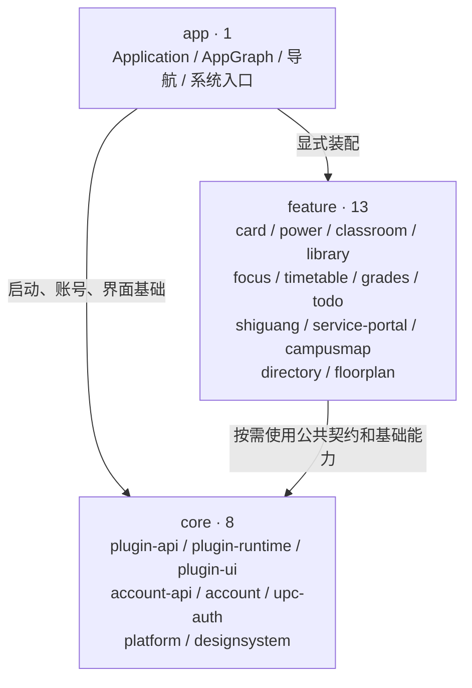
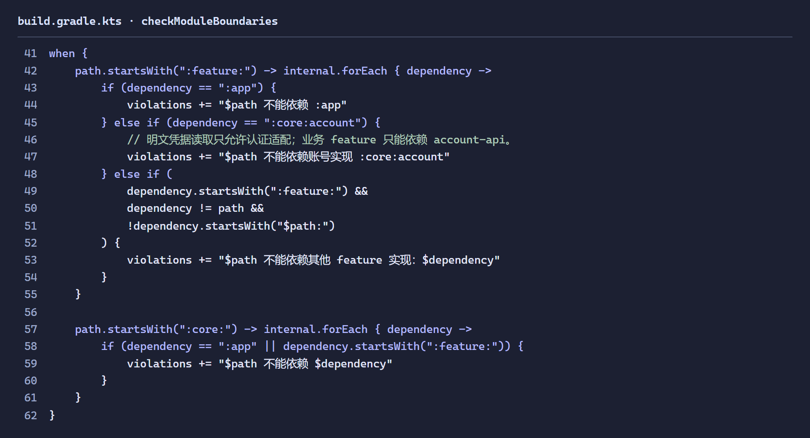

# 我用 22 个 Gradle 模块写了个大学校园 App，是过度设计还是真香？

大众向标题　零后端服务器！我给中石大手搓了一个原生校园助手

午饭前查校园卡余额，下一节课前看教室，晚上再看看图书馆有没有座。每件事都很小，串起来却要在好几个学校网页和微信入口之间切换。做 UPC Pocket 时，我想把这些日常操作放回手机里。首页能看今天的课，桌面小组件能扫一眼周课表，服务里有电量、选座和两校区地图。已同步的课表和随应用分发的地图，断网时也能打开。

*图 1　2.1.0 宣传素材中的首页与桌面小组件。截图来自离线 Android 模拟器，首页使用演示课程，周课表组件展示未配置状态。*

我选择省去自建业务服务器。需要学校认证时，Android 客户端直接跟对应的学校服务通信。断网时，可以在本机读已有缓存。这样，我可以把账号密码留在用户设备与学校认证之间，也省下处理集中凭据、维护数据库和给业务代理续费的工作。学校服务的可用性依然会影响同步，因此离线页面、缓存时间和失败状态都得由客户端认真处理。 [架构与数据流](../../ARCHITECTURE.md) · [隐私与数据说明](../PRIVACY.md)

这个选择把复杂度留在了 App 里。一卡通、课表和图书馆各有会话、解析和缓存，组件又有自己的刷新入口。如果它们都依赖一个能拿到所有服务的对象，新增一项功能很快就会变成在别人的代码里补条件。而学校改一次课表接口，我希望改动范围能明确到几份文件。

## 22 个模块各自负责什么

仓库早期的模块化记录里有 18 个 Gradle 模块。公开的 2.1.0 带上校园地图和通讯录后是 20 个。本文用的开发源码又加入了成绩与学分、卓越楼平面图，达到 **1 个 app、8 个 core、13 个 feature**。所以下载 2.1.0 和查看当前源码，会看到两套不同的模块数。 [早期架构审计](../agent-native/2026-11-16-audit-and-delivery.md) · [2.1.0 正式版模块清单](https://github.com/dlam12138/UPCPocket/blob/v2.1.0/settings.gradle.kts) · [开发源码模块清单](../../settings.gradle.kts)

*图 2　当前开发源码的 Gradle 架构。箭头概括依赖方向，各 feature 的直接依赖以 Gradle 声明为准。*

我把这套结构叫作内置插件式微内核。宿主负责启动、导航、设置和桌面组件等系统入口。Core 提供插件契约与运行时、可复用的界面、账号边界及学校认证适配。每个 feature 纵向持有自己的业务、数据和 UI。校园卡模块自己解释余额和流水，课表模块自己决定一周数据何时算完整。一个 feature 需要另一项业务的能力时，由宿主接线。

点课表详情里的上课地点，可以打开校园地图。课表把当前选中的地点文字交给注入的动作，宿主从已激活插件里查找地图能力，再交给地图选点。地图的路网、定位和选点逻辑归地图模块。地图能力缺失时，课表仍能显示地点文字。后来做卓越楼平面图，也可以给它单独的服务入口和楼层资源。 [插件边界 ADR 001](../adr/001-module-and-plugin-boundaries.md) · [内部契约](../../API.md)

桌面小组件也需要在应用页面关闭时工作。有校园卡组件时，宿主安排余额的周期刷新，查询目标和快照的判定仍在校园卡模块。点整卡则由宿主处理导航。页面和小组件共用余额快照与展示口径，布局随各自空间而变。这样，检查余额格式或改缓存规则时，只要找到维护数据的地方，就能沿着同一条路径核对两种入口。 [组件与业务数据流](../../ARCHITECTURE.md#只读课表与组件)

这些插件随 APK 一起编译和分发。开发时新增一个业务，需要在 Gradle 里注册模块，为稳定 ID 声明宿主兼容区间、依赖和能力，还要在 `AppGraph` 显式提供工厂。多写的几处接线换来了一个很实在的回答。当我准备移除功能时，可以沿着入口、能力和数据归属把影响找全。

## 一道 Gradle 依赖门禁

把模块图画在文档里很容易。真正让它生效的是根 `build.gradle.kts` 中的 `checkModuleBoundaries`。它遍历子项目各配置声明的 project 依赖。如果校园卡直接依赖课表实现、core 反向依赖 app，或者普通 feature 引入能读取凭据的账号实现，任务就会汇总违规的边并失败。基础 API 也各有白名单。改坏哪条规则，输出就显示哪条边。

*图 3　根构建脚本的依赖方向检查片段。*

它是需要显式执行的 Gradle 构建期校验，Windows 下可以运行 `.\gradlew.bat checkModuleBoundaries`。如果一次跨业务改动只是要借用一种能力，任务报告会提醒我把接线放回宿主。公共模块里该不该出现一个业务实体、宿主注入的接口够不够窄，还得靠契约和代码审查判断。 [构建脚本](../../build.gradle.kts) · [贡献流程](../../CONTRIBUTING.md)

## 启动装配失败时怎么降级

依赖方向合法，插件仍可能在启动装配时失败。宿主先把描述符和工厂交给 `PluginRuntime`，由它校验兼容性和依赖关系，做拓扑排序，再按顺序实例化并校验能力。只有整份能力通过校验，实例和能力才会进入激活集合。页面、服务入口和设置等 UI 贡献同样先放进一份临时注册表，通过校验再合并，避免留下一个指向无效页面的按钮。

Debug 版尽早暴露装配错误。Release 版发现插件装配失败时，停用它和所有**必需依赖它**的插件，同时保留独立的健康插件。Provider、Worker 和导航都从最终集合取能力，入口可以按能力缺失降级。这套熔断只覆盖启动装配阶段。插件共享同一 APK 和进程，业务运行期间仍要分别处理请求失败和异常状态。 [插件运行时](../../core/plugin-runtime/src/main/kotlin/com/upcpocket/app/plugin/runtime/PluginRuntime.kt) · [宿主 UI 装配](../../app/src/main/java/com/upcpocket/app/core/HostUiAssembly.kt)

到本文取材的开发快照，仓库已有 285 次提交。我现在拆出一个新功能时，会先问三件事。它拥有哪些数据，会借用哪些公共能力，缺席时宿主怎么继续工作。回答得清楚，划一个 Gradle 模块就有实际收益。改一处时少翻几处代码，也是我愿意维护这些边界的原因。

下一篇从一个更棘手的瞬间开始。校园卡查询还在路上，用户已经切换了学号。原来的余额回来了，App 凭什么知道它该丢掉？ [第 2 篇 · 端侧安全与防串号](02-account-safety.md)
