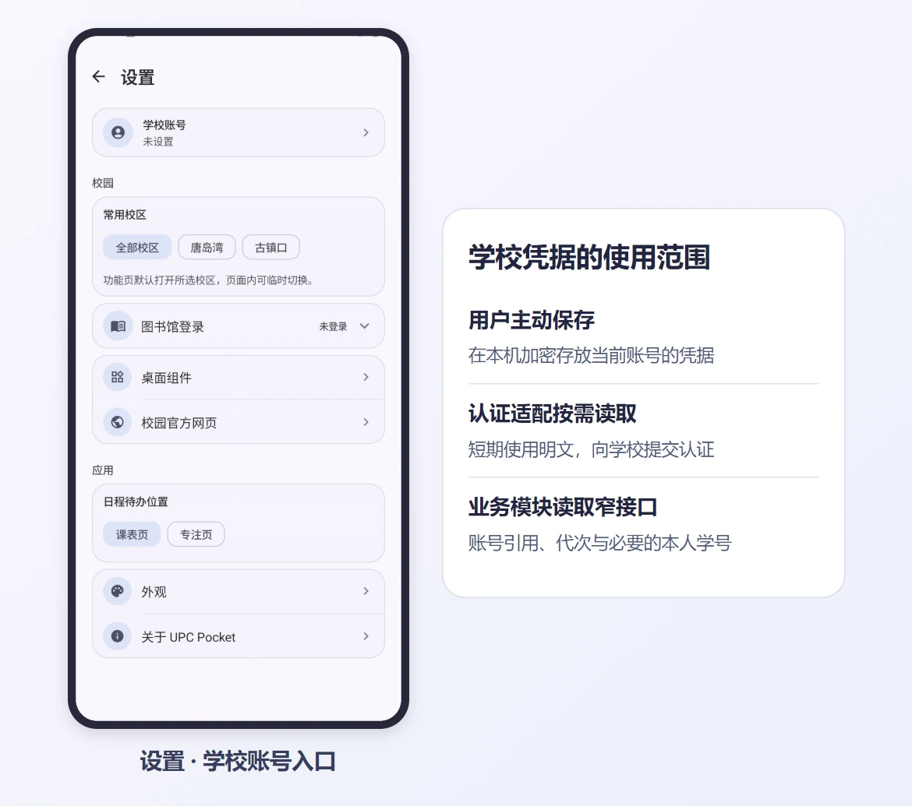
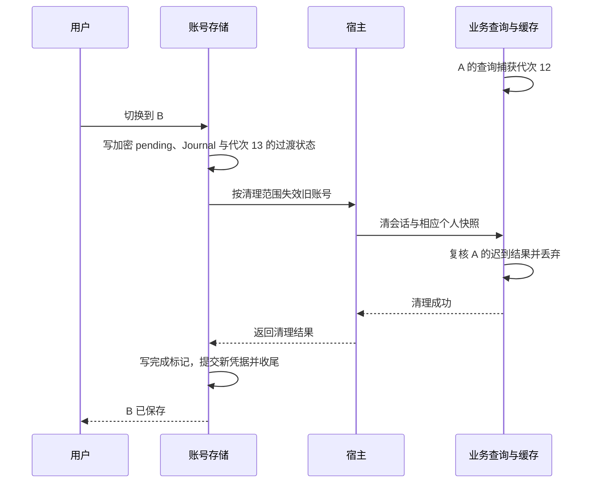

# 没有后端服务器，校园 App 怎么安全存账密？我用 Keystore 和代次防「串号」

大众向标题　开源校园软件安全吗？揭秘我给 App 做的「防串号」与本地加密机制

想象这样一个操作。你刚点完刷新余额，趁页面转圈去设置里换了一个学校账号。第二个账号已经显示在设置里，第一笔查询这时才回来。如果页面只知道「这是一份余额」，旧账号的数字就可能出现在新账号的卡片上，被桌面组件看见，甚至存成下次启动要读的快照。文件加密得再好，也解决不了一次写入发生在错误的账号上下文里。

这就是我做账号模块时同时面对的两个问题。一方面，课表、图书馆等业务需要学校统一身份认证 CAS 建立各自的会话，已有业务会话过期时，可能得再次用到本机凭据。另一方面，无论请求发了多久、应用是否重开，每份结果都要能确认自己属于谁。前一个问题落在密码的读写边界，后一个落在账号代次和清理事务上。 [学校账号及业务会话](../../ARCHITECTURE.md#本机账号与业务会话)

## 密文留在本机，明文只交给认证适配

设置里的学校账号默认等待用户配置。只有主动点「加密保存到本机」，才会存下当前一个账号的登录凭据。保存成功后，界面显示「已保存」，内部状态是 `SAVED_UNVERIFIED`。这个动作只确认本机存储成功。用户之后进入需要认证的业务时，才由对应适配建立学校会话，页面根据业务结果显示已同步、需验证或失败。

*图 1　离线模拟器中的学校账号入口及数据边界示意。账号表单使用 Android 的 `FLAG_SECURE` 保护，画面取自设置页。*

账号密钥由 Android Keystore 管理，凭据以 **AES-256-GCM** 加密。每次加密生成新的随机 IV，GCM 在解密时也校验密文完整性。密文放在应用私有的 `noBackupFilesDir`，该目录排除在 Android 自动备份之外，应用的备份与设备迁移规则还排除了相应数据。Keystore 的硬件保护级别取决于设备和算法支持，项目使用的是系统的密钥管理接口。 [Android Keystore](https://developer.android.com/privacy-and-security/keystore#ExtractionPrevention) · [Android 备份范围](https://developer.android.com/identity/data/autobackup#Files)

凭据、会话和查询结果承担不同的职责。课表业务会话用自己的 Keystore 密钥加密，持久化时带上账号和凭据代次。课表周缓存和余额快照则是应用私有目录里的 JSON，由 Android 应用沙箱和备份范围保护。离线读课表时，页面依靠完整周快照和归属判断能展示什么。只有查询过、结果完整而且确实没有课的那一周，才适合显示空课表。 [项目隐私说明](../PRIVACY.md) · [数据归属 ADR 003](../adr/003-data-ownership-and-schema-compatibility.md)

权限也要在代码里切开。普通业务从 `core:account-api` 拿到状态、内部账号引用与凭据代次，确实需要学号的业务才读取受控的本人学号。例如余额查询只用当前本人学号。获取明文的接口由宿主交给 `core:upc-auth` 认证适配，还要求显式 opt-in。适配为一次登录短时使用凭据，关闭凭据时清零持有的可变密码数组。组件、Worker 和业务数据层依靠各自的窄接口做事，账号实现留在它们的 Gradle 依赖边界外。 [受控凭据接口](../../core/account/src/main/kotlin/com/upcpocket/app/account/SchoolCredentialAccess.kt) · [账号 API](../../API.md#账号状态与受控身份)

认证适配拿到会话后，各业务按协议确认数据归属。图书馆读取服务端的本人字段，再与本机账号比对。课表索引则依据本次业务会话和本机账号引用判断归属。用户看到一份课程时，客户端能确认的是这份结果由当前账号的课表会话取得。 [账号与会话 ADR 002](../adr/002-account-generation-and-business-sessions.md) · [课表和图书馆的数据范围](../PRIVACY.md)

## 给每次查询带上当时的账号代次

我给本机凭据加了一个递增代次，可以把它理解为账号 Epoch。用户保存、改密、换号或删除账号时，事务推进到新的凭据代次。异步查询出发时，记录发起它的账号引用、凭据代次，还可以带上业务会话或查询自己的版本。读取凭据的短暂临界区结束后才做联网认证。用户可以在网络调用未结束时更改账号，认证适配返回时也会复核当初那一代还是否有效。

结果回来时，持久化与界面发布走各自的复核。假设 A 的查询发出时使用代次 12，用户随后切换到 B，账号已进入代次 13。那么 A 返回得再完整，凭据代次的检查也会拒绝它。即使后来又切回 A，较早的会话也属于另一代。同一个账号内，还有业务代次、查询版本处理更细的竞态，比如用户连续切了两个教学周，较慢的旧周响应到达时，页面仍应显示当前所选周。 [账号代次契约](../../API.md#账号状态与受控身份) · [业务数据流](../../ARCHITECTURE.md#核心业务数据流)

这套校验还会检查账号清理状态。因为切换中间有一段时间，应用里可能仍保有上一轮的会话和组件快照。我让账号先进入过渡态，撤下旧引用，业务入口等待清理结果。页面收到了过期快照就丢弃，组件刷新也使用最终确认的归属。单靠取消界面上的协程，很难同时照顾已经开始的后台任务和可能迟到的网络回包。

## 用事务日志把清理接回去

换号既要保存新密文，又要处理旧会话和个人数据，中间随时可能遇到进程退出。实现里，有新凭据时先写一份加密的 `pending`，然后写明新旧代次、操作和清理范围的事务日志（Journal），把过渡状态持久化。接着由宿主请求相应业务清理会话或个人缓存。插件没有激活时，宿主也能走对应的固定清理路径。

*图 2　以换号为例。代次拦截迟到结果，事务日志让清理可以在冷启动时续做。*

清理成功后，日志先写成已完成的标记（Tombstone），然后再提升新密文或删除旧凭据，提交最终状态并收尾。若应用在清理中间退出，下次冷启动可以从日志恢复，重复执行仍待完成的清理。若完成标记已写入，重启只补做提交或收尾，避免重复清掉后来产生的数据。清理报错会保留阻断状态，等重试走完才恢复业务。 [账号事务实现](../../core/account/src/main/kotlin/com/upcpocket/app/account/SchoolAccountRepository.kt) · [数据归属 ADR 003](../adr/003-data-ownership-and-schema-compatibility.md)

清理范围由操作决定。为同一账号更新本机保存的密码会使旧会话失效，归属明确的离线课表可以继续显示。换号和删号处理上一账号的个人会话和快照。待办、专注和寝室配置属于本机的各个功能，按自己的生命周期管理。这里还有个具体例子。只更新本机密码时，如果学校那边已有一笔充值待核对，标记继续属于同一个账号。旧会话已经失效，用户在新凭据下完成本人验证，才可以按原标记只读查单。这样既能断开旧认证，又能把未完成事项留给正确的人。 [充值数据边界](../PRIVACY.md#校园卡微信充值)

这部分最值得守住的其实是操作的时间点。账户设置什么时候可以交出新引用，业务什么时候可以落盘，首页和组件什么时候可以显示数字。把这些要求写进状态机，应用才有办法在用户换号、网络延迟或重新打开时给出一致的答案。

下一篇就从认证适配继续往下走。学校要求验证码时，流程在哪里停？点了一次微信充值却等不到响应时，又要凭什么决定能不能再点？ [第 3 篇 · CAS 与充值防重](03-protocols.md)
