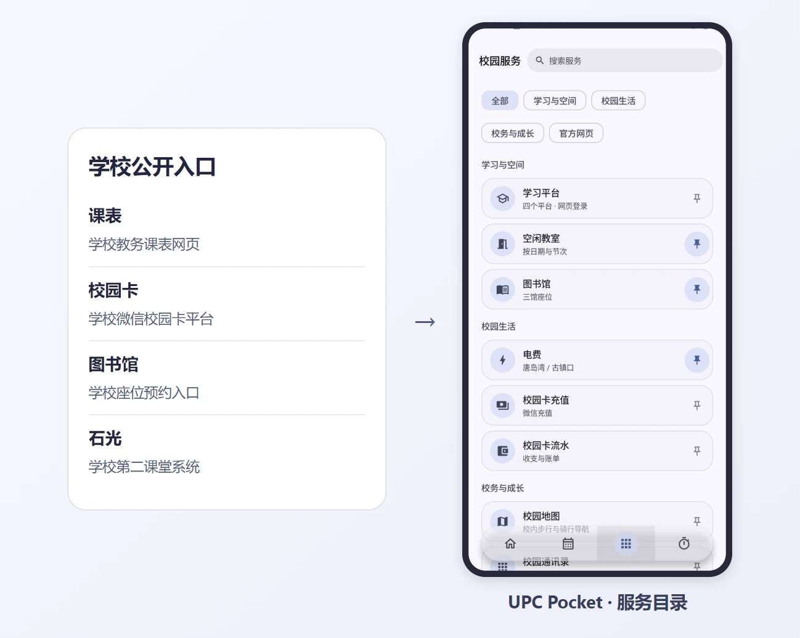
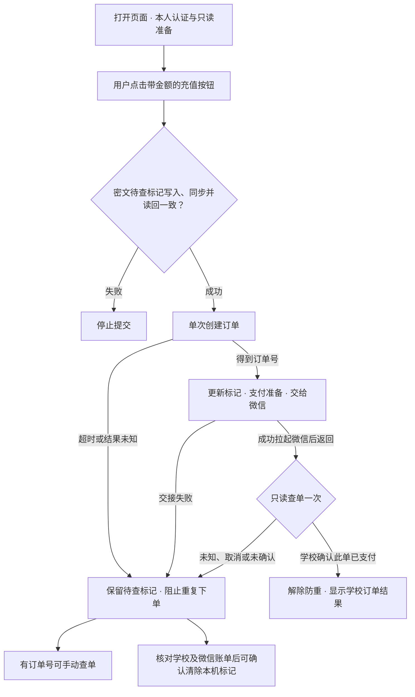
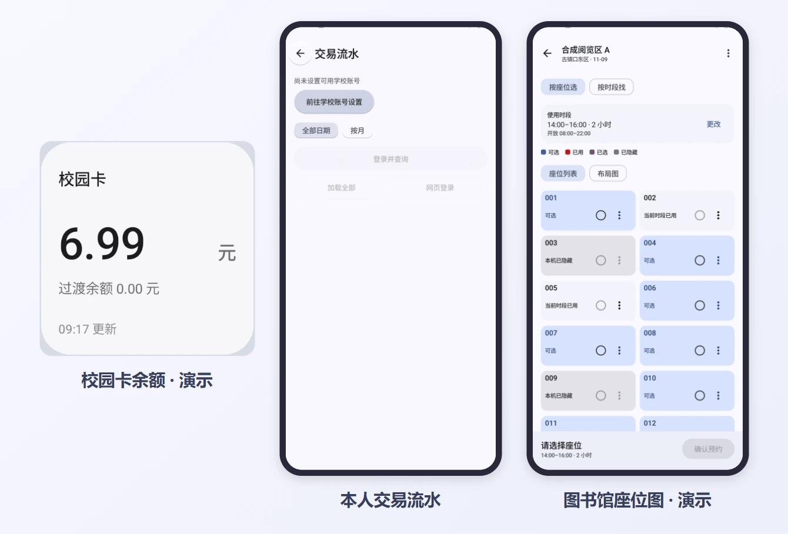

# 从 CAS 认证到微信充值防重锁：高校异构系统客户端的协议治理实践

大众向标题　查课表、校园卡和图书馆，我把哪些学校网页做成了原生页面？

想从课表接着查饭卡，再去看晚上还有没有图书馆座位，入口可能分别在学校网页、微信和另一个登录页面。我做 UPC Pocket 的服务页时，先把「去哪里办」这个问题收拢起来。课表、余额、本人流水和图书馆选座有原生页面，石光能查看活动和本人学分记录。体育馆、游泳馆预约则把学校的办理方式放在入口旁。点同一个服务页里的卡片，下一步去哪儿、会发生什么，应该在点之前就能知道。

*图 1　左侧是学校公开入口示意，右侧是离线模拟器中的 UPC Pocket 服务目录。* [服务来源](../upc/官方入口.md)

## 验证码出现时，把登录交还给用户

原生课表、流水和选座看起来用了同一个学校账号，背后各自要建立业务会话。以 CAS 为例，认证适配先进入与该业务对应的登录流程，登录凭据只提交至核对过的 `cas.upc.edu.cn` 官方 HTTPS 表单。成功后，学校向目标服务签发一次性服务票据（Service Ticket）。业务再沿自己的回调建立会话，按能拿到的字段确认归属。图书馆要核对本人，课表要检查可用的索引和当前账号上下文。余额查询的路径更短，只读取受控的本人学号。 [Apereo CAS 服务票据规范](https://apereo.github.io/cas/7.3.x/protocol/CAS-Protocol-V2-Specification.html#31-service-ticket) · [项目认证边界](../PRIVACY.md)

认证失败后，客户端需要知道是哪一步停了。凭据错误，一次认证尝试只提交一次密码，并提示用户检查。网络断开，页面保留网络失败的含义。遇到验证码或其他需要在网页完成的步骤，认证适配返回 `INTERACTION_REQUIRED`，页面提供一个由用户主动打开的官方网页登录入口。在支持接续的业务里，受控 WebView 只走核对过的学校流程，用户自己输入验证码或完成二次验证。回来之后，客户端仍要验证业务会话，确认它属于发起时的账号和代次，再接着读数据。 [网页登录提示与验证范围](../research/2026-11-14-login-verification.md) · [认证契约](../../API.md#受控认证)

这种做法允许失败停在准确的位置。用 OCR 识别验证码会让客户端替用户处理学校设定的交互环节，还把原本清楚的「请继续验证」变成难诊断的尝试。我更愿意把这一步建立在学校页面上。同样，唐岛湾体育馆和游泳馆提供预约规则以及「复制公众号名并打开微信」。用户自己进入学校公众号完成预约。石光和 e站通保留活动、指南和本人进度等只读入口。 [2.1.0 场馆入口记录](../design/2.1.0-update-plan.md) · [产品范围](../../README.md)

图书馆的原生选座也能说明这个区别。列表和座位图是对同一个房间布局的两种展示，点中的是同一个座位，之后还要核对所选日期和时段。读取余位与提交预约是两个动作，只有用户在最终确认后，才发送一次预约请求。如果请求发出后结果未知，就提示去核对学校记录。因为切换呈现方式或者改进登录回退，都不应该让用户在多处提交同一个预约。 [图书馆业务边界](../../feature/library/AGENTS.md)

## 微信充值的第一步写在本机

充值的棘手之处在于，App 看见超时和学校收到请求可以同时发生。用户点一次充值，网络断在回包前，可能是请求没到，也可能是订单已经创建。此时提示「失败，请重试」会让人再发起一笔订单。校园卡原生充值由 PR #5 贡献，整合时保留了原本用来处理未知结果的约束。**先可靠保存待查标记，再发出本次订单创建请求。** [充值贡献 PR](https://github.com/dlam12138/UPCPocket/pull/5) · [充值集成记录](../releases/2.0.6-card-recharge.md)

用户进入充值页时，App 先做本人认证和只读准备。用户点击带金额的充值按钮后，服务把本次尝试绑定到当前账号，用独立的 Keystore AES-GCM 密钥把待查标记写入应用私有目录。写入后显式同步文件，再解密读回，核对提交的内容。只有这一关通过，客户端才发出一次创建订单请求。学校返回订单编号后，服务更新并保存待查标记，再进行支付准备，把付款步骤交给微信。密文标记保留查单需要的信息，支付链接和认证凭据各自留在短期使用边界内。 [待查标记实现](../../feature/card/src/main/kotlin/com/upcpocket/app/data/cardrecharge/RechargePendingStore.kt) · [充值服务](../../feature/card/src/main/kotlin/com/upcpocket/app/data/cardrecharge/CardRechargeService.kt)

把标记放到请求之前，意味着有时锁会挡下一次其实尚未送达学校的请求。这是为了覆盖客户端更难判断的情况。如果只在收到订单号之后记录，恰好丢掉回包时，应用重开只会看到一张干净的充值页。现在，即便这次尝试只记录到了账号和金额，页面也会如实说明还有一笔待核对。排队过程中换号，则由身份和代次检查拦住后续步骤。 [校园卡模块约束](../../feature/card/AGENTS.md)

*图 2　校园卡微信充值的本机防重流程。学校订单确认、微信付款和余额到账各有自己的状态。*

成功拉起微信后，第一次回到 App 会触发一次只读查单。已有订单号时，用户之后也可以手动查询。若创建请求的回包就已丢失，本机可能缺少订单号，此时只能提示结果未知，留待用户核对账单。只有学校明确确认同一笔订单支付成功，本机才自动解除防重。取消、失败和超时都保留待查。

用户核对学校订单及微信账单后，可以明确确认清除本机标记。这个入口放在查单与风险说明之后，清掉的范围是设备上的防重记录，退款和订单处理仍归对应服务。充值页显示学校是否确认订单。对于已经付完款的人，余额还会随另一次余额查询更新，可能要等不同的时间。 [充值的隐私与状态说明](../PRIVACY.md#校园卡微信充值)

*图 3　离线模拟器素材。余额和座位为演示数据，交易流水展示待登录状态。*

这次集成的研发记录里，真实学校请求验证覆盖本人认证和只读准备。创建订单、微信分发、付款、学校确认以及余额到账需要各自的证据。做第三方校园工具时，我会先把这种边界讲清楚，再决定哪一步值得接入原生流程。 [2.0.6 校园卡充值集成](../releases/2.0.6-card-recharge.md)

下一篇离开登录页，去看两张放进手机里的校园地图。唐岛湾最后几十米要下车步行，到了卓越楼还得知道房间在几层。 [第 4 篇 · 离线地图、楼层图与界面取舍](04-offline-and-ui.md)
