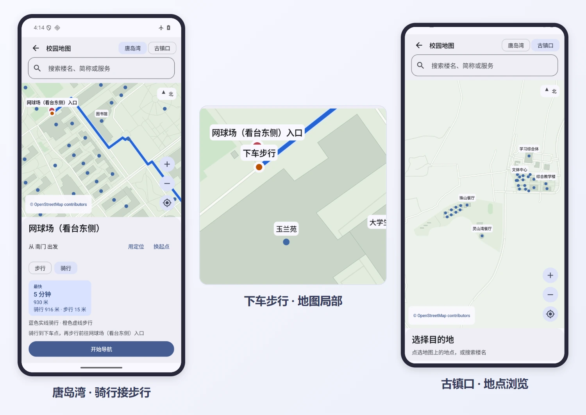
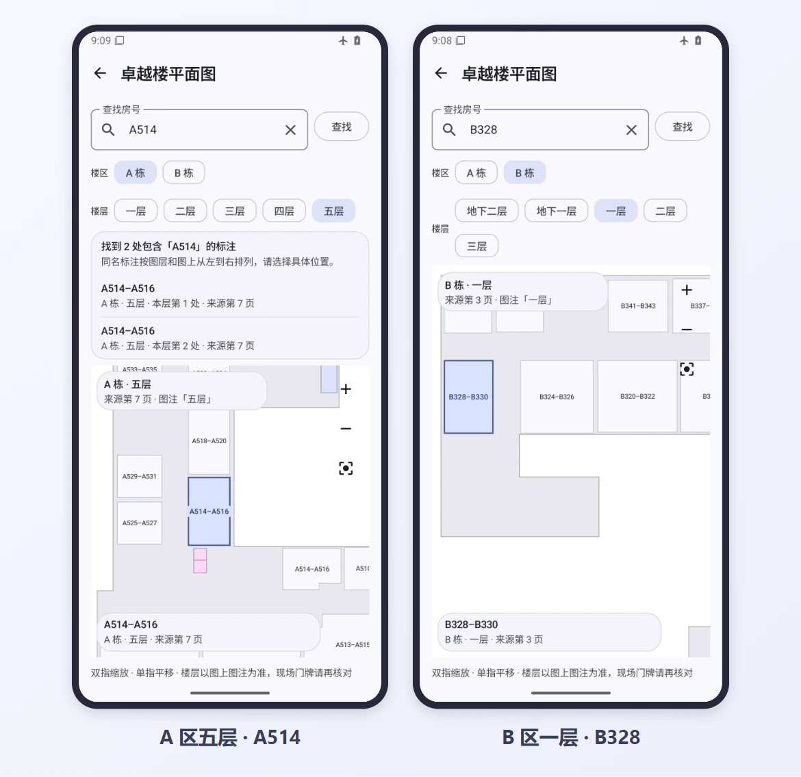
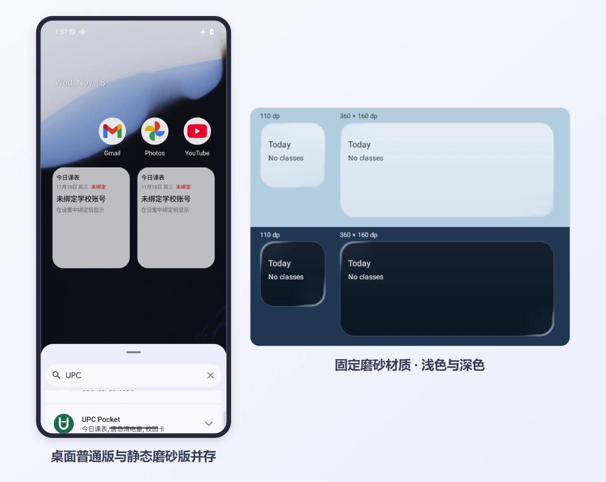

# 端侧离线 OSM 混合算路，以及我为什么砍掉了「液态玻璃」特效（ADR 006）

大众向标题　给学校手搓了离线骑行转步行导航和教学楼平面图

从唐岛湾南门骑去看台东侧网球场，预览里最后一小段会从蓝色实线变成橙色虚线，地图上也多了一个「下车步行」的标记。骑到这里，再走进去。把这个选择画进路线，需要手机知道哪些边可以骑，哪些边只能走，以及场地入口究竟接在哪一条路上。

*图 1　左侧和中间为 2.1.0 正式 APK 的唐岛湾离线模拟器路线预览及下车点局部，右侧为同版宣传素材中的古镇口地图浏览。底图 © OpenStreetMap contributors。* [OSM 数据和许可](https://www.openstreetmap.org/copyright)

## 校园里最后几十米怎么走

两校区地图使用随包分发的 OpenStreetMap 派生路网和建筑几何，再叠加经核对的校园地点与部分楼门接线。地点查询、路线预览和算路都在本机完成。室外引导打开时，应用在本机使用 Android 前台定位提供的位置和精度，更新剩余路线，确认偏航后按当前出行方式重算。地图更新随应用资源发出，路网缺边或点位接路不准，就得回到数据里核对。古镇口东区可以用已收录的道路规划，西区目前更适合查地点，部分楼栋之间缺少连通路。

混合路线可以理解成两张叠在一起的有向图。骑行层保留能骑的边，步行层保留能走的边。规划先检查骑行能否直接到已知入口。需要接一段步行时，算路器允许从骑行层切到同一个节点的步行层，且整条路线最多切换一次。两层按各自的速度计算耗时，再用带优先队列的 Dijkstra 搜索耗时较短的走法。图中给出下车点和两段距离，进入步行段后偏航也按步行重算。下车点表示出行方式切换的位置，停车条件要看现场。

算路准确到什么程度，一半看搜索，一半看数据。比如地图图钉落在网球场内，能规划到的终点则应是场外入口。接入那段步道前，需要核对接线是否穿过建筑或球场轮廓，沿途是否有支持步行的边。如果学校给一栋楼标了多个入口，算路就从已接入路网的入口里比较耗时。补好一条门前短路，有时比给最短路算法加新规则更管用。 [路线实现](../../feature/campusmap/src/main/kotlin/com/upcpocket/app/campusmap/CampusRouting.kt)

南门到看台东侧网球场的那次预览约是骑行 916 米、步行 15 米。这个数字来自已收录路网和楼外接线的离线计算。正式记录验证了路线绘制与分段，实际楼门开放、现场通行以及真机跟随表现还要到校核对。 [离线导航 ADR 007](../adr/007-offline-campus-navigation.md) · [2.1.0 发布验证](../releases/2.1.0.md)

## 到了楼门口，换一张图

另一个常见问题是到了古镇口卓越教学楼，手里只有「A233」这样的房号。2.1.1 开发源码给了平面图一个独立的服务入口。A 区收录一至五层，B 区收录地下二层到地上三层。按原图把楼层轮廓、房间、楼梯和可辨认的电梯重绘成结构化矢量数据，由原生画布显示，支持选层、缩放、平移和复位。

房号搜索用的就是图块本身的索引。输入 A233，唯一匹配后切换到 A 区二层并高亮房间。遇到 A 区五层原图上重复的 A514 标记，界面会列出两个位置供选择。图面靠随包提供的数据查找，适合进楼后对照门牌。离线模拟器已覆盖 A、B 区切换与搜索，门牌仍待现场核图。 [2.1.1 开发与验收记录](../design/2.1.1-update-plan.md#古镇口卓越教学楼-ab-平面图)

*图 2　2.1.1 开发版离线模拟器验收，左为 A514 两个候选位置中的第一个，右为 B328。*

## 液态玻璃的账，要在列表滑起来以后算

2.0.8 候选曾尝试在应用内给卡片和导航做实时背景采样、模糊与折光。停在一页看效果有意思，滚动时背景一直变化，连续采样就会占用渲染预算。用户在手机上反馈卡顿。同一台 API 36 模拟器的短采样里，原候选玻璃模式的帧时 P95 为 550 毫秒，Material 3 为 18 毫秒。两种模式采样帧数也不同。这组数字记录的是一次候选对照，手机证据来自使用反馈。 [2.0.8 候选性能记录](../releases/2.0.8-development.md#2026-11-18-应用主题与桌面外观决定)

ADR 006 据此把应用主题恢复到 Material 3。2.0.9 又提供了单独开关的轻量玻璃，默认仍是 Material 3。桌面小组件是另一套选择。今日课表、校园卡、电量、待办分别提供独立的静态磨砂 Provider，用固定资源画雾面和高光，可以跟普通版并存，沿用对应的渲染、点击和刷新逻辑。本周课表及开发版的今明课表使用桌面全局外观设置，各自有独立布局。 [主题与组件 ADR 006](../adr/006-2.0.8-material-theme-and-glass-widgets.md) · [组件架构](../../ARCHITECTURE.md#只读课表与组件)

*图 3　左为 2.0.8 候选的两种今日课表组件并存，右为浅色与深色下的静态磨砂材质渲染。*

我很喜欢下车点和静态磨砂能放在同一篇里。前者把算力用在决定下一步怎么走，后者让一块桌面卡片开箱就有质感。路网该补就补，实时特效该收就收。最后一篇聊聊这些选择怎么写进 ADR，以及我如何用仓库规则跟 AI 一起维护它们。 [第 5 篇 · 工程治理与 AI 协作](05-engineering.md)
