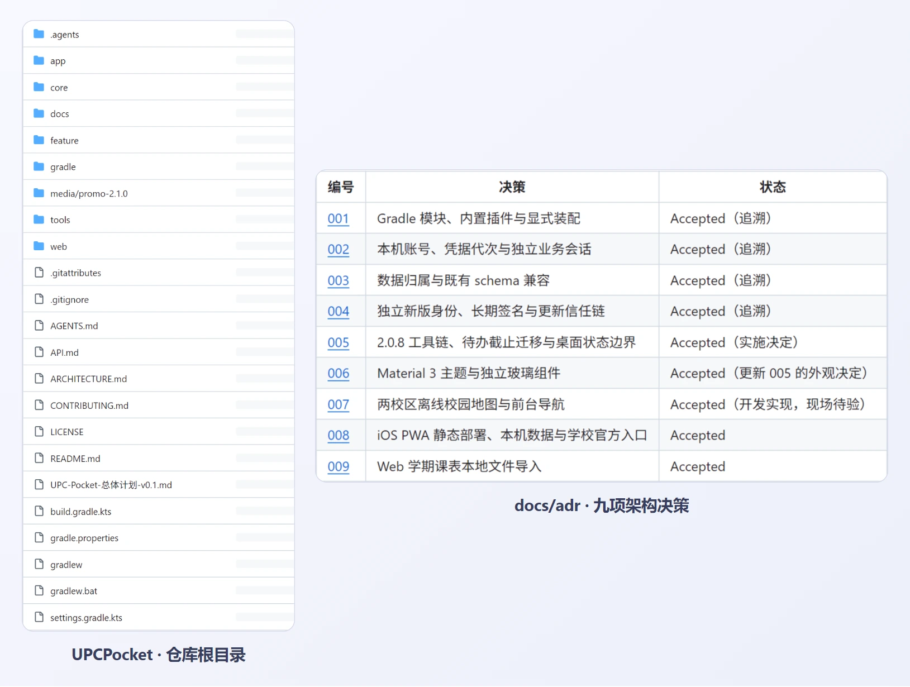
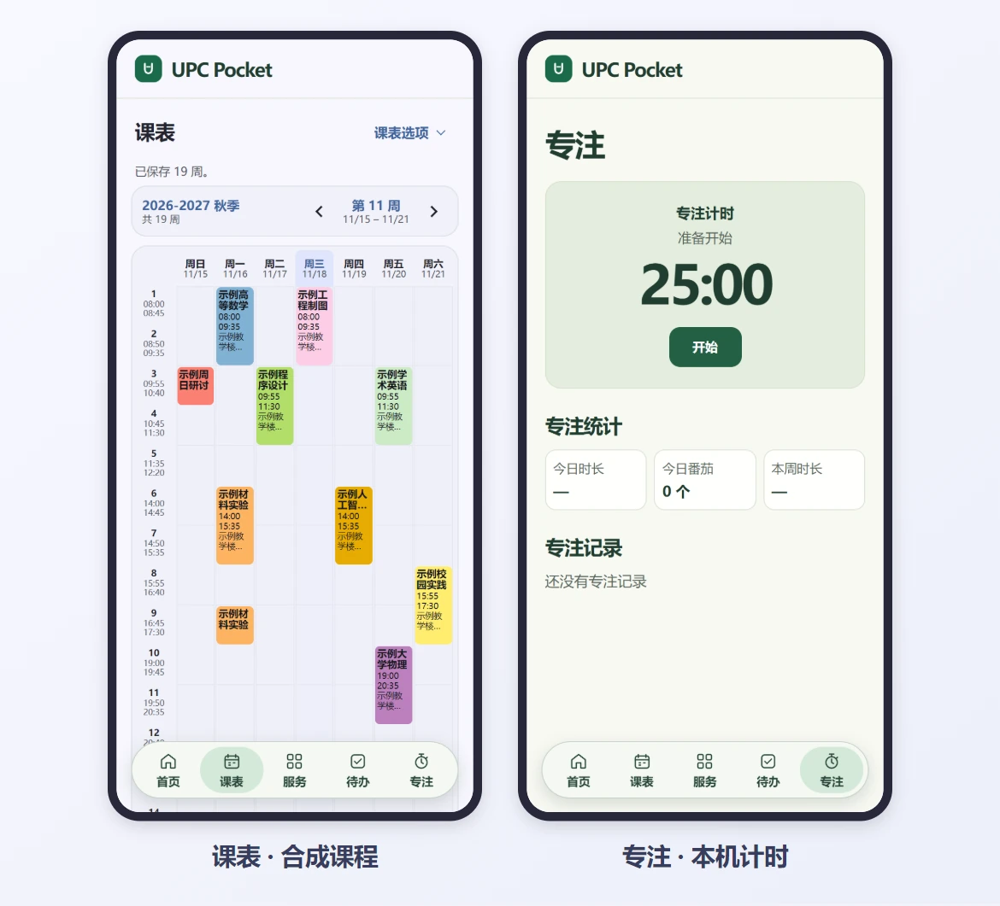
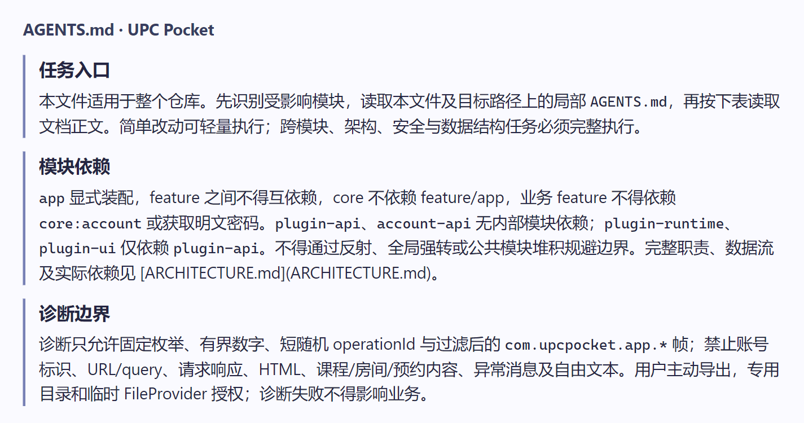

# 一个校园 App 的 280 多次提交，我如何用 ADR 和 AGENTS.md 与 AI 协作

大众向标题　关于这个开源校园项目，我想聊聊文档规范、iOS 网页版和 AI 协作

打开 UPC Pocket 的仓库，会看到 22 个 Gradle 模块、独立的架构与隐私文档、9 份 ADR，还有一套给 iPhone 用的静态网页版。本文取材时，主线累积了 285 次提交。我承担了主要维护工作，也收到不少贡献。Lycoris 的网页版、同学贡献的原生微信充值、图书馆筛选与个人隐藏的反馈，都成了项目的一部分。规模上来之后，我最怕的是两个月后再打开一段代码，只看得出它怎么跑，想不起当初为什么要这样跑。 [仓库及致谢](../../README.md#许可与致谢)

*图 1　公开仓库的文件入口和 ADR 索引。*

## 把当时的取舍留下来

ADR 是架构决策记录。我把影响依赖边界、数据兼容或信任链的选择写进去，记下当时的背景、采用的做法、其他选项和维护代价。当前的模块职责放在 `ARCHITECTURE.md`，接口放在 `API.md`，敏感数据的处理方式放在 `PRIVACY.md`。当方案后来演进，旧 ADR 还能交代为什么曾经那么选，长期变更另写记录并关联。九条记录里有对已有实现的补记，也有发布之前做出的取舍。 [ADR 索引](../adr/README.md) · [架构说明](../../ARCHITECTURE.md) · [隐私与数据说明](../PRIVACY.md)

这些决定会在实际改动里互相牵动。ADR 002 写了账号代次、个人数据归属和独立业务会话，提醒我加一个新同步入口时也得检查换号。ADR 006 记了哪一版候选的实时玻璃被撤下、桌面静态磨砂为什么按 Provider 独立。ADR 007 把离线路网和前台定位的能力写得很细，连古镇口西区的覆盖缺口、已核对的楼门和实际通行待验也能查回去。没做出改变之前，先把这几条读一遍，往往就知道该去哪里找需要验证的内容。 [账号 ADR 002](../adr/002-account-generation-and-business-sessions.md) · [玻璃 ADR 006](../adr/006-2.0.8-material-theme-and-glass-widgets.md) · [地图 ADR 007](../adr/007-offline-campus-navigation.md)

## iPhone 上把课表带进静态网页

来自 Lycoris 的 PR #16 提供了 PWA 的基础。最终整合进 `web/` 的版本选择了静态 HTTPS 部署，Service Worker 缓存应用外壳，课表、待办和专注记录放在浏览器的 IndexedDB。本机专注计时可以恢复，结束时用一次读写事务归档会话。图书馆和空闲教室等学校业务由用户打开官方页面办理。这样一来，网页端能把日常工具放到 iPhone 主屏幕，学校继续掌握自己的登录和会话，项目也省下代登录和云端存储。 [网页版贡献 PR](https://github.com/dlam12138/UPCPocket/pull/16) · [静态 PWA ADR 008](../adr/008-ios-pwa-local-data-and-school-links.md) · [Apple 添加到主屏幕指南](https://support.apple.com/guide/iphone/iphea86e5236/ios)

*图 2　从仓库 `web/` 生成的移动尺寸浏览器预览，课程为合成示例。*

最费心的是课表怎么进来。Pocket 和学校页面是不同来源，跨站读取与会话访问受浏览器规则和校方授权约束。Safari 标签页和主屏幕网页 App 在这个流程里各有自己的本机记录。我选择让用户在已经登录的学校课表页主动运行 Safari 书签脚本，看过预览并确认后导出整学期 JSON。再回到自己日常使用的 Pocket，通过粘贴或选文件导入。页面检查学期、完整的教学周、日期和课程字段，全部通过后才替换该学期快照。调课后可以重新导入，`.ics` 则供临时预览。 [课表导入 ADR 009](../adr/009-web-semester-timetable-import.md) · [HTML 同源规则](https://html.spec.whatwg.org/multipage/browsers.html#origins) · [WebKit 存储说明](https://webkit.org/blog/14787/webkit-features-in-safari-17-2/)

## 给 AI 的任务先写清边界

最容易交给助手的任务是「让这个页面也能读到某项数据」。困难都藏在「也」字里。直接从另一项业务的存储读取，会把原本独立的模块连在一起。调试认证时如果顺手把完整响应写入日志，又可能让日志带上账号和会话信息。把任务写清楚，需要在改动之前说出这些边界。

根目录的 `AGENTS.md` 是任务入口。它先让协作者定位受影响的模块，再去读该路径的局部指令、契约和相关 ADR。比如改充值要先读根、`feature/` 和 `feature/card/` 的指令，顺着证据核对本人范围、待查标记和一次提交的规则。账号与认证变更还要核对明文凭据的读取范围、会话和账号代次。给助手的任务会写清涉及文件、限制和验收标准，让审查时有同一套依据。 [根指令](../../AGENTS.md) · [校园卡模块指令](../../feature/card/AGENTS.md) · [Agent 手册](../agent-native/README.md)

*图 3　仓库根 AGENTS.md 的依赖边界与阅读要求摘录。*

依赖方向可用 `checkModuleBoundaries` 检查，越界使用明文凭据有 Kotlin opt-in 约束，回归用相关模块的既有测试验证。涉及学校服务时，还要照实际做过的验证来写结果。一个人负责合并，也可以请不同角色检查方案、实现和证据。最终我会核对实际差异和验证范围，再决定能不能交付。碰到一条经常被误读的规则，先把触发条件补清楚，下一次任务便能直接用它。

以开发中的成绩与学分为例。任务写到「把成绩展示出来」还不够，要同时说清谁发起教务同步、页面打开时读什么、账号换了以后旧快照怎么处理。按现在的边界，成绩插件维护自己的会话和加密快照，进入页面只读本机，点同步才访问学校。旧会话和换号后的缓存要走各自的失效路径。审查可以从入口一路跟到账号清理，再核对哪些结论来自模拟器，哪些仍需要对照学校成绩单。 [2.1.1 成绩与学分开发记录](../design/2.1.1-update-plan.md#成绩与学分)

同一套方法也约束交付文字。比如提到卓越楼，发布记录能查到下载包提供的功能，开发记录能查到平面图在哪一步通过了模拟器验收。把版本、操作和证据写在能找到的地方，下次接手的协作者就能复核，也少猜一次「已经完成」到底指代码、模拟器，还是真机上的正式版本。 [2.1.0 发布记录](../releases/2.1.0.md) · [贡献流程](../../CONTRIBUTING.md)

从第一篇的插件边界，到账号轮换、充值待查、地图接路，再到 iPhone 上的本机导入，项目一直在回答同一类具体问题。数据归谁，谁能发起操作，遇到失败后用户会看到什么。

欢迎中石大同学下载体验。遇到课表同步、地图点位或房号问题，可以带着版本和脱敏后的操作路径来提 Issue。也欢迎其他学校的同学参考这套端侧架构，从自己学校允许的入口和真实需求开始做。 [GitHub 仓库](https://github.com/dlam12138/UPCPocket) · [正式版下载](https://github.com/dlam12138/UPCPocket/releases/latest) · [提交反馈](https://github.com/dlam12138/UPCPocket/issues)
