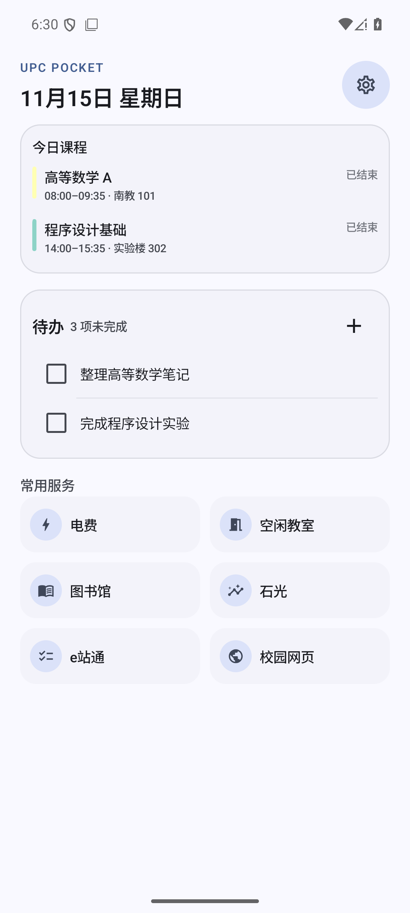
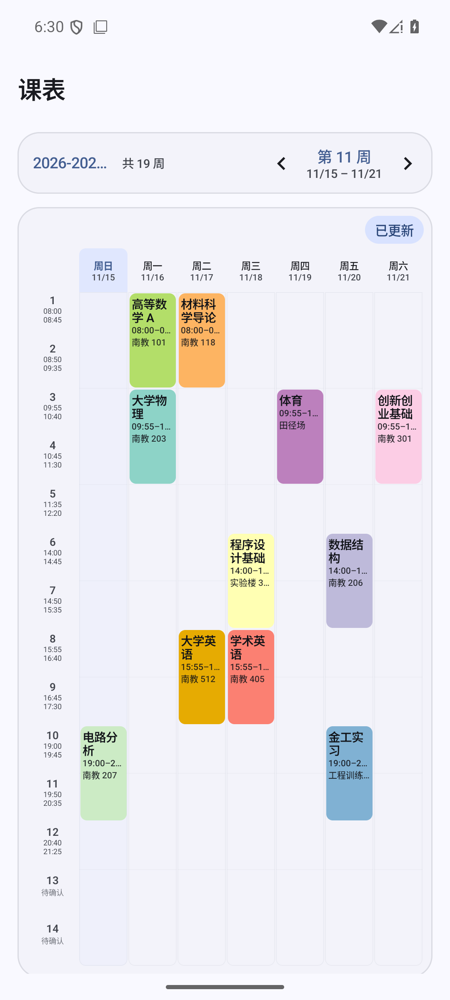
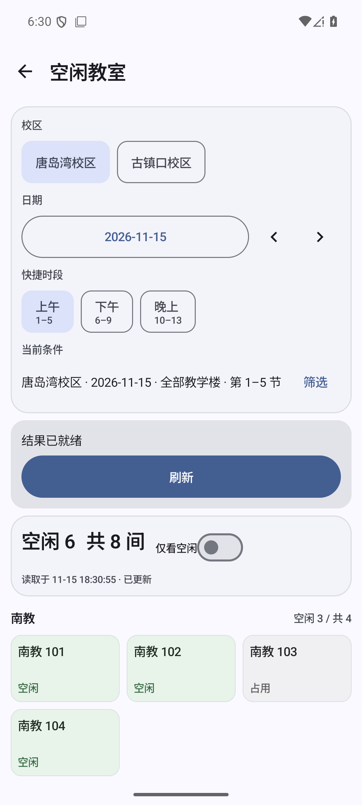
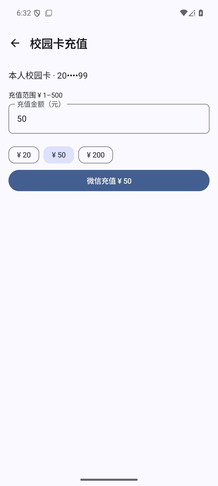
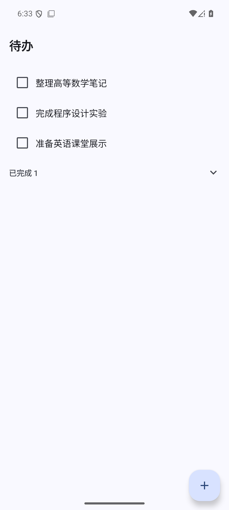

# UPC Pocket 2.0.6：让校园日常更顺手

**2.0.6 已于 2026-11-15 正式发布，现为 latest。**

打开首页，先看到今天的课程；待办与常用服务更紧凑，课表、空闲教室和查询结果也更清楚。图书馆登录默认收起，学校账号保存后简洁显示“已保存”。

新增本人校园卡微信充值：**输入金额 → 点击充值 → 拉起微信**。实际付款在微信内确认，返回后可查询订单状态；未知结果会保留防重保护。

- [GitHub 下载](https://github.com/dlam12138/UPCPocket/releases/download/v2.0.6/UPC-Pocket-2.0.6.apk)
- [国内加速](https://gh-proxy.org/https://github.com/dlam12138/UPCPocket/releases/download/v2.0.6/UPC-Pocket-2.0.6.apk)
- 安装包约 **5.34 MiB**，支持 Android 12 及以上。

新版 2.0.4/2.0.5 可检查更新或直接覆盖安装，无需卸载。2.0.6 旧候选请手动下载正式包覆盖；旧版 2.0.3 可与新版共存，旧版数据不迁移。

感谢 [PR #5 作者](https://github.com/dlam12138/UPCPocket/pull/5) 贡献原生充值实现。下方推广图中的课程、待办、教室和充值数据均为合成演示。

[完整更新与校验信息](2.0.6.md) · [反馈问题](https://github.com/dlam12138/UPCPocket/issues)
