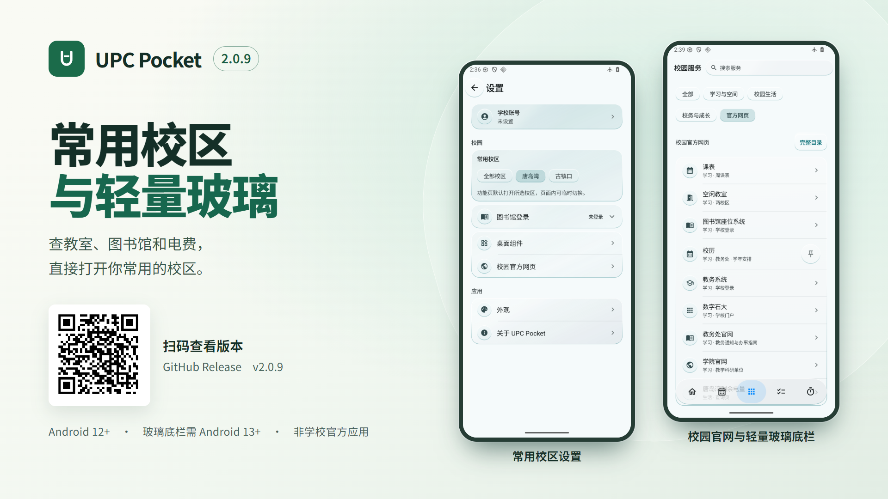

# UPC Pocket 2.0.9 · 常用校区与轻量玻璃

- **常用校区。** 在「首页 → 设置 → 校园」选择唐岛湾、古镇口或全部校区。空闲教室、图书馆和电费会按偏好打开，页内仍可临时切换。
- **校园官网。** 在「服务 → 官方网页」可以找到教务系统、数字石大、教务处官网和学院官网，点按后由系统浏览器打开。两校区的网页都可在完整目录找到。
- **可选轻量玻璃。** 在「首页 → 设置 → 外观」切换，默认仍是 Material 3。Android 13 及以上可显示玻璃底栏，Android 12 沿用 Material 3 底栏。本版修复首页快速下拉后的回弹，并调整底栏、待办浮层和短提示的显示。
- **课表。** 周视图仅将节次重叠的课程并排，点按课卡可查看完整信息。首页重读同一账号的当天缓存时保留已显示的课程。桌面「今日课表」的两种外观都能用已同步课表显示上课剩余分钟，系统后台限制可能延迟刷新。
- **图书馆选座。** 修复唐岛湾选择有效的「现在」后无法进入预约确认的问题。放大布局图后，格子空间足够时会显示完整座号。古镇口东区和求是使用不同图标。

## 下载与更新

安装包约 **5.94 MiB**，支持 **Android 12 及以上**。已安装新版 2.0.4–2.0.8 的同学可从「设置 → 关于 UPC Pocket → 更新」检查更新，也可下载 APK 覆盖安装。同签名的 2.0.9 验收包可手动覆盖升级。2.0.3 旧版可与新版并存。

- [GitHub 下载 APK](https://github.com/dlam12138/UPCPocket/releases/download/v2.0.9/UPC-Pocket-2.0.9.apk)
- [gh-proxy 国内加速](https://gh-proxy.org/https://github.com/dlam12138/UPCPocket/releases/download/v2.0.9/UPC-Pocket-2.0.9.apk)
- [Release 与校验文件](https://github.com/dlam12138/UPCPocket/releases/tag/v2.0.9)

## 致谢

感谢 **@Seven-ninths** 贡献可选轻量玻璃，并改进玻璃底栏、浮层显示与首页今日课程的缓存切换。[PR #12](https://github.com/dlam12138/UPCPocket/pull/12) · [PR #13](https://github.com/dlam12138/UPCPocket/pull/13)
