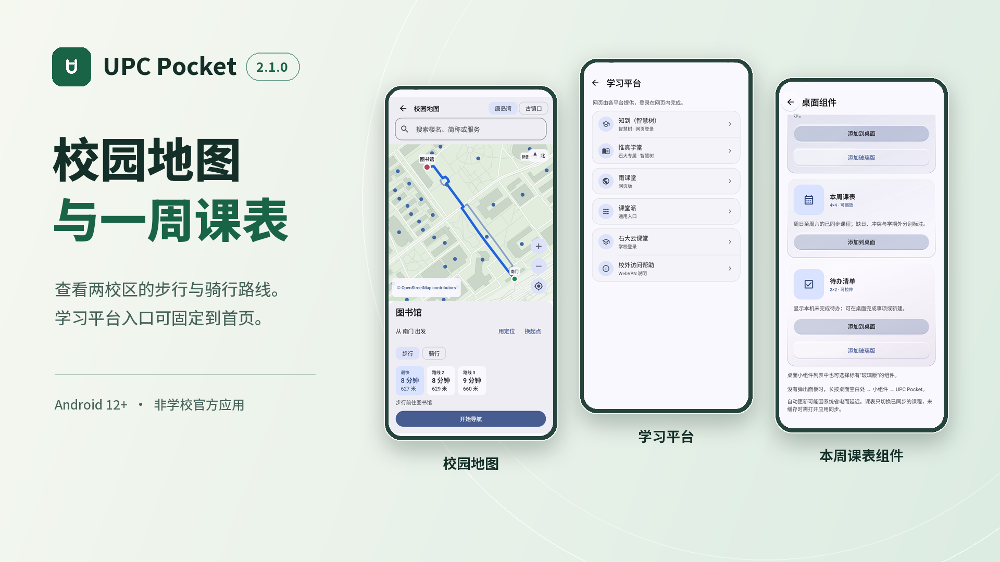

# UPC Pocket 2.1.0 · 校园地图、学习平台与桌面周课表

> 本页保留发布前草稿。当前下载和验收结果见 [2.1.0 正式发布记录](2.1.0.md)。

找教室、查办事窗口、打开学习平台，把本周课程放到桌面。UPC Pocket 是面向中国石油大学（华东）的非官方 Android 校园工具。

## 校园地图与通讯录

- **校园地图。** 搜索唐岛湾、古镇口的校内地点，对比步行和骑行路线。地图与路网随应用提供，可在本机算路。开始导航后，在前台显示当前位置、剩余路线和转向指引。课表详情里的地点也可交给地图查找。骑行需要接步行时显示下车点，蓝色实线是骑行，橙色虚线是步行。唐岛湾补录看台东侧网球场入口及体育馆、讲堂群、文理楼三处楼门的步行接线。
- **校园通讯录。** 按校区查找学院、部门和办事窗口，查看电话与地址。点号码打开系统拨号器，已关联地图的地址可查看路线。
- 古镇口西区目前以浏览地点为主，主要路网待补。请以现场楼门开放和通行情况为准。

## 课表、待办与学习平台

- **本周课表。** 新增 4×4 桌面小组件，按周日至周六显示已同步的课程和节次。点整卡进入课表，首次使用需先同步。
- **日程待办。** 默认在课表页顶部，也可从「首页 → 设置 → 应用 → 日程待办位置」移到专注页计时下方。两处共用本机待办、截止时间和一次性提醒。底部提供首页、课表、服务和专注四个入口。
- **学习平台。** 在服务页集中打开知到（智慧树）、雨课堂、课堂派、石大云课堂和惟真学堂，也可查看云课堂校外访问说明。学习平台入口与教务系统等校园网页均可固定到首页「常用服务」。网页由系统浏览器打开，平台登录在浏览器内完成。

## 校园生活

- **体育馆与游泳馆预约入口。** 在服务页打开预约说明，复制「中国石油大学体育场馆」公众号名并打开微信。场次、余位和预约结果在公众号内查看。游泳馆入口归唐岛湾。
- **唐岛湾图书馆。** 进入选座、从预约记录切回选座或手动刷新时，重新读取学校开放的预约日期。仍有效的日期和馆区会保留。
- **交流与反馈。** 「设置 → 关于 UPC Pocket」可复制 QQ 交流群号。关于页也提供版本检查和本机诊断报告入口。

## 界面截图

截图来自离线 Android 模拟器，地图画面展示步行路线预览。

[校园地图](https://raw.githubusercontent.com/dlam12138/UPCPocket/main/docs/images/2.1.0/promo/campus-map.png) · [学习平台](https://raw.githubusercontent.com/dlam12138/UPCPocket/main/docs/images/2.1.0/promo/learning-platforms.png) · [本周课表组件](https://raw.githubusercontent.com/dlam12138/UPCPocket/main/docs/images/2.1.0/promo/week-widget.png)

## 下载与更新

2.1.0 正在准备发布。签名安装包、校验文件和更新附件将在候选验收后补齐。当前可下载的正式版为 2.0.9，支持 Android 12 及以上。旧版 2.0.3 可与新版独立安装。

[当前正式版](https://github.com/dlam12138/UPCPocket/releases/tag/v2.0.9) · [2.1.0 开发与验收记录](https://github.com/dlam12138/UPCPocket/blob/main/docs/design/2.1.0-update-plan.md)

## 致谢

感谢 @Seven-ninths 贡献校园地图与导航、校园通讯录。 [地图与导航](https://github.com/dlam12138/UPCPocket/pull/14) · [校园通讯录](https://github.com/dlam12138/UPCPocket/pull/15)
