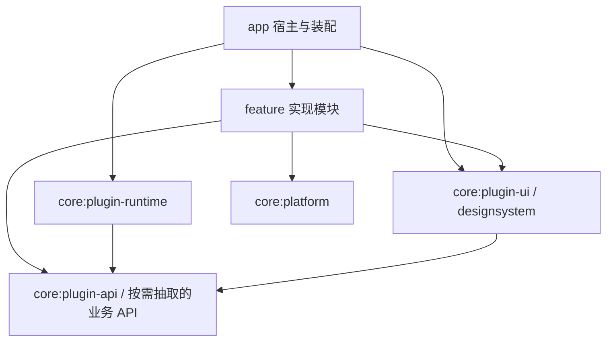

# UPC Pocket 模块化与插件化工程方案

版本：v0.1 · 2026-11-02  
状态：待实施；下一阶段首要任务 M0。本文只确定工程顺序，不代表模块拆分已经完成。

实现进度更新（2026-11-03）：M0 已完成工程实现与模拟器回归，记录见
[M0 执行记录](m0/README.md)；M1 账号基础与 M2 余额绑定已在此基础上实现，见
[M1 执行记录](m1/README.md)、[M2 执行记录](m2/README.md)。M3—M5 仍未实现。以下方案原文保留。

## 1. 目标与实施顺序

先把现有 UPC Pocket Lightly 整理为可独立维护的 Gradle 模块和功能插件，再新增账号密码保存、校园卡账号关联及课表。插件化不能停留在目录改名或接口空壳：已提供的功能必须实际迁入模块、通过插件入口装配，并受依赖检查约束。

整体顺序调整为：

```text
M0 现有工程模块化与插件化
  → M1 统一账号基础
  → M2 校园卡余额绑定账号
  → M3 课表认证、查询与展示
  → M4 图书馆统一认证整合
  → M5 统一页面安排、交互与视觉设计
```

M0 完成前不混入新业务接入。账号、余额绑定与课表的详细要求见 [统一账号与课表工程方案](统一账号与课表工程方案-v0.1.md)；该方案的功能优先级保留，执行起点改为本文。

石光与 e站通仍低优先级、按需增加，不作为 M5 的前置条件；若后续决定纳入同一轮产品设计，先确定其必要功能再统一安排页面。

### 1.1 页面和交互后置原则

用户确定将页面安排与设计放到本轮核心能力完成之后。分阶段执行如下：

| 阶段 | 页面与交互要求 |
| --- | --- |
| M0 结构重构 | 保持现有页面显示、文案、入口顺序、底部导航、点击结果、返回栈、输入保留、刷新及组件行为；UI 文件和依赖可移动，实现行为应等价 |
| M1—M4 功能接入 | 仅增加功能必需的账号设置、课表页面、入口和真实状态；按各阶段要求修改登录与余额绑定语义，沿用现有视觉与布局，不重排全应用 |
| M5 页面设计 | 在核心功能稳定后统一确定首页内容、栏目分组、导航层级、入口位置、交互细节与视觉样式；首页今日课程摘要在此阶段安排 |

M0 不承诺移动代码天然不会影响 UI：资源 namespace、依赖注入、导航注册及状态归属变化都可能引入回归，必须以现有显示与交互为基线验证。修复重构导致的状态丢失、错误跳转或组件失效属于 M0，不能留到 M5。

插件 UI 契约表达稳定入口、默认顺序与页面贡献，宿主决定最终位置和呈现；不得将首页排布或底部栏位置写死在业务协议/Repository 中。这样 M5 调整页面时无需重写网络、认证与缓存。

## 2. Personal-Assistant 的参考依据

本轮只读参考本机 Personal-Assistant，基准提交为 `e3d222d612c87258b6eda2597372f5622787dd70`。参考范围是以下架构与实现，不复制其私人资料、运行状态、配置或业务源码：

- `docs/adr/0001-plugin-runtime.md`：功能通过公开命令入口关联，禁止跨插件引用实现；插件声明依赖及数据归属。
- `agent/core/runtime.py`：注册命令、路由和订阅，记录插件元数据，提供调用与诊断入口。
- `agent/plugins/campus_mcp/plugin.py` 与 `agent.md`：功能目录自带说明及注册逻辑，适配器隔离外部系统。
- `agent/tests/test_refactor.py` 的边界测试：检查跨插件数据访问、只加载选中插件时的行为。

参考的实际代码在加载时读取启用列表、记录依赖，诊断阶段再检查缺失依赖；不能假定它已经实现了依赖拓扑排序或初始化事务。Android 方案需要自行补足这些保证。

| 借鉴原则 | UPC Pocket 的落实方式 |
| --- | --- |
| 功能通过少量公开入口关联 | Kotlin 类型化能力契约和插件注册；页面、组件、后台适配器使用同一业务能力 |
| 功能声明依赖与所有权 | PluginDescriptor、构建依赖及模块说明；注册项标明所属插件 |
| 插件之间不引用实现 | 不允许 feature 实现模块相互依赖；确需协作时抽取小型 API 契约 |
| 插件维护自己的数据 | 余额、电量、图书馆、专注各自维护业务模型、存储与迁移 |
| 统一诊断与边界检查 | 注册冲突检查、依赖检查、模块依赖检查和可删减装配测试 |

保留 Android/Kotlin 的类型检查，不照搬 Python 字符串命令加任意字典作为所有内部调用形式。API 清单与调用错误应可枚举，不能引入包含密码、票据或业务原文的通用诊断输出。

## 3. 插件化的定义与边界

本阶段采用**Gradle 多模块、随 APK 编译的内置插件、显式注册与依赖注入**。不做下载 DEX/APK、外部代码加载、热更新、独立进程 RPC 或第三方插件市场。

“可插拔”指宿主从装配清单移除某功能后，其他独立功能仍能编译和运行，入口与调用返回明确的不可用状态；不要求本轮增加面向用户的运行时启停开关。插件不是安全沙箱，同一 APK 中的文件和内存仍受同一应用进程及权限约束。

M0 保留原应用标识、最低系统版本、工具链、Compose / Material 3、手动装配、Room / DataStore 和 RemoteViews。模块化不构成升级 AGP、迁移 Hilt、Navigation 3 或 Glance 的理由。

## 4. 目标模块与职责

下面是 M0 的目标结构；不提前创建没有实现的石光、e站通或课表空模块。模块名确定后同步 Gradle 清单和文档。

```text
app/                       应用入口、宿主导航与页面布局、插件装配清单
core/
  plugin-api/              插件标识、版本、依赖、能力与错误契约
  plugin-runtime/          注册、依赖校验、能力解析、诊断与生命周期协调
  plugin-ui/               Compose 页面、首页卡片、设置项的贡献契约
  designsystem/            主题、通用组件、排版与布局常量
  platform/                无业务模型的加密、基础存储、学校 Cookie 等平台适配
feature/
  card/                    余额协议、快照、Repository、页面卡片、余额组件适配
  power/                   电量协议、房间输入、快照、页面、电量组件适配
  classroom/               空教室模型、协议、Repository、ViewModel 与页面
  library/                 图书馆模型、协议、会话、登录、查询、预约和取消页面
  focus/                   专注模型、数据库、统计、计时引擎、通知与前台服务
```

模块不只是 UI：各 feature 纵向包含自己的数据、逻辑和展示，内部可按 `api / data / domain / ui / plugin` 分包。只有被其他模块实际消费的契约才拆成独立 `*-api` 模块，避免每个类都拆一个工程。

具体约束：

- `app` 可以依赖各 feature 的公开插件入口并负责显式装配，不承担余额查询、课程解析、账号会话恢复或业务缓存管理。
- `plugin-api`、`plugin-runtime` 优先使用 Kotlin/JVM，不依赖具体业务、Compose 或 Activity。`plugin-ui` 单独承载 Android/Compose 契约。
- `platform` 不允许依赖 `LibraryUser`、课表实体或余额快照等具体业务类型。平台存储只提供基础能力；业务数据结构归所属插件。
- 首页和“更多”的布局由宿主拥有，内容通过插件贡献生成；不再分别硬编码校园服务目录、路由入口和业务卡片。M0 的贡献元数据与渲染结果保持现有位置和顺序，不借插件化重排页面。外观、关于等宿主设置可以留在 app。
- 专注是现有有效 Room 数据的所有者，M0 可将完整旧数据库及兼容声明迁入 focus 模块，保持原文件名、实体全限定名、schema 和版本。旧课表表只是遗留兼容负担，不因此变成新的共享课表模型。
- 后续账号基础是共享核心能力，有独立账号 API 与认证实现边界；不能塞进某个业务插件再让其他插件反向依赖。课表等新增功能遵守同一插件契约。

允许的主要依赖方向：



feature 实现模块之间不互相依赖，core 不依赖 feature 实现，模块不得依赖 app。不得用反射、全局单例强转或把全部实现塞进公共模块来规避边界。

## 5. 最小插件契约

实现前先确定以下契约，避免迁移到一半才各自发明一套注册方式：

| 契约 | 最小内容 |
| --- | --- |
| PluginDescriptor | 稳定 pluginId、插件版本、宿主 API 兼容版本、必需/可选依赖和能力声明 |
| 功能入口 | 显式创建插件实例，按需注入 Context、平台能力和声明过的类型化 API；不接收任意业务的全局 AppGraph |
| 注册器 | 以插件为单位暂存能力、页面、卡片与设置项；全部验证通过才提交，禁止重复 ID/路由覆盖 |
| UI 贡献 | 稳定 entryId、展示顺序、标题/图标、归属插件和页面渲染入口；宿主掌握导航控制器，不把任意路由直接暴露给外部 Intent |
| 业务能力 | 类型化请求、返回与 Flow 状态；区分不可用、未登录、无缓存、业务失败和有效空结果 |
| 生命周期 | 注册不联网、不启动采样、不修改业务记录；按需创建实例，后台服务由显式用户行为触发 |
| 清理协作 | 预留有序的业务会话/个人数据失效接口，供后续统一账号协调；不得提前实现保存密码或改动现有账号行为 |

能力、页面和卡片命名带插件归属，例如 `card.balance`、`power.tangdaowan`。稳定 ID 是兼容契约，改名需要迁移或别名策略，不能随 Kotlin 类名变化而变化。

运行时在实例初始化前检查版本兼容、重复插件、缺失必需依赖与依赖环，按依赖顺序初始化。失败插件不留下半注册入口；依赖它的插件不启用，独立插件仍可用。配置错误应在开发构建/测试中明确失败，在发行环境提供脱敏诊断，不能静默假装成功加载。

注册与展示层移除插件后，导航、首页与设置列表一并消失；可选能力消费者显示不可用。即使 Android Manifest 仍保留旧 Provider 或 Service 作为兼容入口，也必须在执行时检查注册状态，不得绕过停用状态触发业务。

## 6. 已知耦合点及拆解办法

| 当前耦合 | M0 拆解方向 |
| --- | --- |
| 页面、Worker、Service 直接读取 AppGraph | AppGraph 收缩为宿主装配；插件内部显式注入 Repository/平台能力，系统组件经受控引导入口取得所属插件能力 |
| SchoolSessionStore 依赖 LibraryUser | 通用加解密下沉 platform；图书馆会话序列化与模型归 library；保留旧密文、key alias、Preference 名称与键的兼容读取 |
| UiPrefsStore 同时承载主题、学号和寝室 | 主题为宿主偏好，业务通过各自类型化存储接口管理自有键；迁移期只保留一个旧文件的 DataStore 实例，不重复打开同一文件 |
| 页面在查询后直接调用 WidgetUpdates | 页面调用业务能力，成功快照/清理状态由插件统一通知组件适配器；Worker 使用同一 Repository |
| WidgetRenderer 同时理解余额和电量模型 | 渲染与刷新适配分别归 card/power；通用调度部分只处理稳定插件 ID 与组件标识 |
| PomodoroNotifications 引用 MainActivity | 注入宿主提供的显式 PendingIntent/导航能力；focus 不反向依赖 app |
| LibrarySeatScreen 同文件承担 ViewModel 与会话恢复 | 分离页面、ViewModel、会话协调；页面专注渲染及用户事件 |
| CampusServices 与 AppNav/HomeScreen 分别列出功能 | 迁为插件 UI 贡献；入口元数据保持 UPC 来源与当前访问条件 |
| 注释、Gradle 说明停留在早期原型 | 随迁移同步实际职责与依赖，清除失效说法，不伪造新功能已完成 |

不要为拆模块把所有 `internal` 批量改成 `public`。只开放契约和插件入口；协议解析、缓存文件和页面内部状态保持模块内可见，相关测试随实现迁入所属模块。

## 7. 明天的执行清单

按以下顺序推进，每一步完成后再进入下一步；这是工作拆分，不承诺一天内完成全部阶段。未完成 M0 时下一次继续 M0，不跳到账号或课表。

| 顺序 | 工作 | 交付与检查 |
| --- | --- | --- |
| M0.1 | 固定现有基线，列出跨包依赖、持久文件、组件/服务 FQCN 和测试归属 | 现有构建/单测/lint 结果；数据与系统组件兼容清单，不读取个人业务原文 |
| M0.2 | 建立 Gradle library 配置、plugin-api/runtime、UI 贡献契约及依赖检查 | 最小插件注册可测；重复 ID、缺依赖、依赖环与半注册失败有测试 |
| M0.3 | 抽离通用 UI 与最小平台能力，收缩 AppGraph | core 不反向依赖 feature；代码行为、主题及数据格式不变 |
| M0.4 | 以余额做第一条纵向迁移，包含输入、查询、快照、首页和组件 | 原有“输入学号查询”行为保留；组件刷新/清除不回退；移除插件后不影响专注 |
| M0.5 | 依次迁移电量、空教室、图书馆、专注 | 各自数据与测试归属模块；最后移出专注数据库与服务，逐项验证兼容 |
| M0.6 | 宿主统一消费插件贡献，消除旧硬编码与跨实现依赖 | 主 app 留装配与壳；现有页面和入口顺序不变，依赖边界与当前功能回归通过 |
| M0.7 | 核对迁移记录、覆盖安装和精简装配 | 出具 M0 验收结果与未验证项，满足退出条件后才开始 M1 |

M0.4 的余额插件化不同时改为统一账号绑定；保留当前行为用于判断重构是否引入回归。账号绑定单独在 M2 改，避免结构问题与业务变化混在一次验收中。

M0.5 允许逐功能、逐提交迁移，过渡期可用显式适配器接旧实现，但必须列出归属和移除步骤。不能以“已建模块目录”或“所有插件仍经同一个全局 AppGraph 访问所有业务”宣告完成。

## 8. 数据与 Android 兼容要求

- 保持 `applicationId`、升级签名方式、数据库文件、已有 DataStore/Preference/快照路径、加密 key alias 与历史数据读取兼容。必要迁移须显式、幂等，并验证中断恢复。
- M0 不主动改变 Room schema、删除旧表、重置数据库或调用 destructiveMigration。移动类仍需检查导出 schema 的 identity hash 与实际数据库兼容性，不能只看编译成功。
- 已安装桌面组件、排队 Worker、前台 Service 和 PendingIntent 的类名/标识可能被系统持久化。优先保留旧全限定名；必须变更时在宿主保留兼容入口或提供明确迁移，不能把改包名当成无影响移动。
- library module 资源改用自己的 namespace/R，核对 Manifest 合并结果、显式 exported 设置、Intent 白名单、图标和 Worker 初始化。包名不变也不能默认资源引用不变。
- 注册插件不得导致启动时额外联网、自动登录、自动预约或增加后台轮询。两个组件继续由用户点击触发刷新，失败保留各自成功值与时间。
- 不新增保存密码、不扩大网络主机例外、不请求额外权限；这些属于后续有明确范围的独立改动。

## 9. 验证与 M0 退出条件

### 9.1 工程检查

- 全部目标 feature 是实际 Gradle 模块，独立拥有实现与测试；app 不再残留业务协议、数据库管理或会话恢复。
- 自动检查禁止 feature 实现互相依赖、模块反向引用 app、重复路由/入口及未声明能力调用；运行时解析能力与声明匹配。
- 至少验证一个精简装配：移除一个无必需依赖的插件，其余独立功能仍可编译运行；旧系统入口返回不可用且不发请求。
- 当前已有测试迁至所属模块并继续通过。拆模块后 `:app:testDebugUnitTest` 不会自动覆盖所有库测试，验证命令要随模块增加。

建议模块化后的全工程常规命令（与实际模块任务核对后执行）：

```powershell
.\gradlew.bat :app:assembleDebug testDebugUnitTest lintDebug
```

Kotlin/JVM 的 plugin-api/runtime 另执行其 `test` 任务。不能只运行 app 的少量测试就声称全工程回归完成。

### 9.2 行为与升级检查

- 余额和电量的原生查询、输入保留、离线缓存、清除与迟到响应隔离。
- 两校区教室筛选，图书馆登录/查询及原有预约/取消入口，专注计时、统计与通知。
- 首页/更多/子页导航、返回栈、主题与大字号，以及两个已有组件的覆盖安装、点击、刷新和失败状态。
- 以重构前页面为基线对照显示和交互，包括入口顺序、滚动/输入状态及旋转或返回后的状态恢复；验证目的为确认等价，不在 M0 加入视觉改版。
- 保留专注历史、旧加密会话和原组件实例；真实 Keystore、WebView 与系统服务行为需设备验证。
- 接口验证仅在实际授权范围内进行；重构回归优先用替身网络与虚构数据，不为验收自动提交预约或报名。

M0 完成须同时满足：实际模块化、插件入口生效、依赖边界受检查、存储/系统组件兼容和现有页面交互等价回归。有未完成设备或接口验证时明确列出，不以构建成功替代，也不提前标记完整验收通过。M5 的视觉与信息架构优化不作为 M0 的交付内容。

## 10. 本轮交付边界

本轮只写入架构方案并调整工程优先级，未修改 Gradle、移动源码或实现插件运行时。参考项目仅作只读研究，未运行其个人数据/任务命令，未修改其文件。

原始总体计划不改；当前发布版 README 与隐私说明继续描述现有功能。后续每次迁移同步相关源码路径、模块清单和验证记录，避免文档继续链接旧目录。
